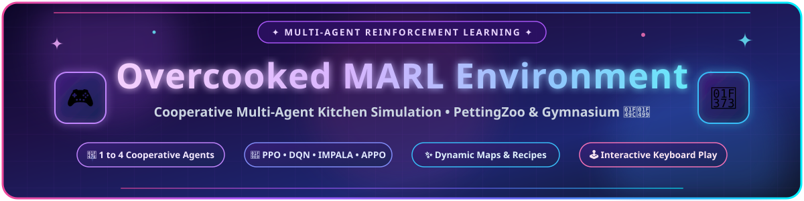
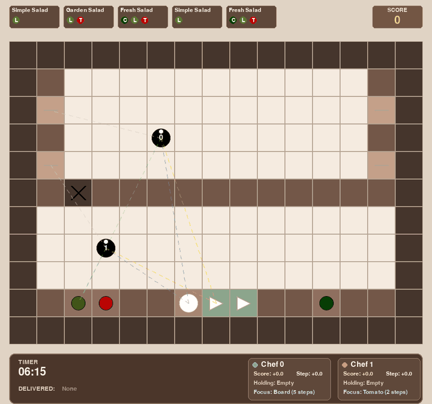
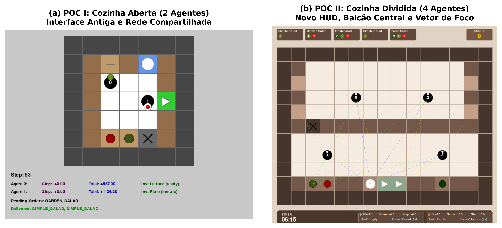

<div align="center">



<br/>

[](https://www.python.org/downloads/)
[](https://pettingzoo.farama.org/)
[](https://gymnasium.farama.org/)
[](./resultados_experimentos/)

A cooperative Multi-Agent Reinforcement Learning (MARL) environment based on the Overcooked game, where agents work together in a grid-based kitchen to prepare, chop, assemble, and deliver delicious recipes. 💜💙

</div>


> [!IMPORTANT]
> ### 📊 Experiment Results & Analyses
> All **experiment results, learning curves, algorithm benchmarks (`PPO`, `DQN`, `IMPALA`, `APPO`, `BC`), and behavioral analyses** conducted so far are organized in:
> 👉 **[`📂 resultados_experimentos/`](./resultados_experimentos/README.md)**

<div align="center">
<table>
  <tr>
    <th align="center">👯‍♀️ 2-Agent Cooperation (Divided Kitchen)</th>
    <th align="center">👩‍🍳👨‍🍳 4-Agent Team (Full Brigade)</th>
  </tr>
  <tr>
    <td align="center" width="50%">
      
    </td>
    <td align="center" width="50%">
      
    </td>
  </tr>
</table>
</div>


## 🍳 What is this environment?

This is a PettingZoo/Gymnasium environment where **agents** must cooperate to:

1. **Collect ingredients** (tomato, lettuce, cucumber, onion, etc.) from dispensers.
2. **Process/Chop ingredients** on cutting boards (requires multiple chop interactions).
3. **Assemble dishes** by combining chopped ingredients on clean plates.
4. **Deliver completed orders** at the delivery stations in the correct sequence to earn scores.

Agents receive shared rewards upon successful deliveries, encouraging them to learn high-level coordination strategies (e.g., dividing labor, passing items over counters, parallel preparation).

<div align="center">
  
</div>


## 🚀 Installation & System Setup

Here is a step-by-step guide to installing everything needed to run, validate, and playtest this environment, starting from the operating system packages.

### 1. System Package Setup (Linux/Ubuntu)
First, update your package lists and install Python 3 along with its package manager and virtual environment support:
```bash
sudo apt update
sudo apt upgrade -y
sudo apt install python3 python3-pip python3-venv python3-full -y
```

### 2. Virtual Environment Configuration
It is highly recommended to isolate your project dependencies using a virtual environment:
```bash
# Create the virtual environment
python3 -m venv venv

# Activate the virtual environment
source venv/bin/activate

# Upgrade pip to the latest version
python -m pip install --upgrade pip
```

### 3. Install Package & Dependencies
Install the required scientific, GUI, and machine learning packages:
```bash
# Install package dependencies
pip install gymnasium numpy pettingzoo pygame matplotlib torch-directml tqdm

# Install the repository package in editable development mode
pip install -e .
```


## 🎮 How to Run

We provide multiple ways to run, test, and interact with the environment:

### 1. Interactive Playtesting (Keyboard Gameplay)
You can play inside the environment manually to test layouts and mechanics using the Pygame window:
```bash
python example/keyboard_play.py
```
* **Agent 0 (Blue):** Move with `W`, `A`, `S`, `D` | Interact with `Spacebar` (pick, chop, place, deliver)
* **Agent 1 (Orange):** Move with **Arrow Keys** | Interact with `Enter` / `Return`
* **Controls:** Press `R` to reset, `Esc` to quit.

### 2. Scripted Cooperation Tests
Run pre-recorded cooperative demonstrations to see agents work together in ASCII/console rendering:
```bash
# Default cooperation scenario
python example/default_map_test.py

# Tutorial map scenario
python example/tutorial_map_test.py
```

### 3. Basic RL/Gymnasium Loop
Use the standard agent loop code below to run a custom script:
```python
from overcooked_marl_env import OvercookedMARL

# Create environment in human display mode
env = OvercookedMARL(render_mode="human")
observations, infos = env.reset()

for step in range(500):
    # Choose actions for all active agents (random sampling here)
    actions = {agent: env.action_space(agent).sample() for agent in env.agents}

    # Step the simulation
    obs, rewards, terminations, truncations, infos = env.step(actions)
    env.render()

    if any(terminations.values()) or any(truncations.values()):
        break

env.close()
```


## 🗺️ Custom Content (Maps & Recipes)

The environment supports dynamic maps and custom recipes/ingredients without rewriting any Python code.

### 1. Creating Custom Maps
Create a `.txt` layout file (e.g. `my_kitchen.txt`) inside your folder:
```text
# Grid Map
_________
|#C#P#D#|
|# 0   #|
|#   1 #|
|#I#I#I#|
_________

# Dispensers (name x y)
tomato 1 4
lettuce 3 4
onion 5 4

# Recipes
SIMPLE_SALAD, ONION_SOUP, ONION_SALAD
```
* **Grid Legend:** `_`/`|` = Wall | `#` = Counter | `C` = Chopping Board | `P` = Plate Dispenser | `D` = Delivery | `I` = Ingredient Dispenser placeholder | `0`/`1` = Agent Spawn positions | Space ` ` = Walkable floor.

### 2. Custom Recipes & Ingredients Configuration (`recipes.json`)
Place a `recipes.json` file in the **same directory** as your custom map file to automatically register new ingredients (color, cuts) and recipes (score reward, requirements):
```json
{
  "ingredients": [
    {
      "name": "onion",
      "color": [235, 150, 235],
      "cuts_needed": 3,
      "char": "o"
    }
  ],
  "recipes": [
    {
      "name": "ONION_SOUP",
      "ingredients": ["onion", "onion", "onion"],
      "reward": 180.0
    }
  ]
}
```

### 3. Validating Custom Maps via CLI
You can validate map grids and recipe configurations from the terminal:
```bash
python -m overcooked_marl_env.map.map_loader example/custom_map_template.txt
```


## 📊 Actions and Observations Specifications

### Action Space
Single agent action space is `Discrete(5)`:
* **0**: Move UP (North)
* **1**: Move DOWN (South)
* **2**: Move LEFT (West)
* **3**: Move RIGHT (East)
* **4**: Interact (pick up from dispenser/floor, chop at board, combine on plate, deliver at station)

### Observation Space
Single agent observation space is `Box(height, width, 9)` (or `Box(150,)` when `featurized_obs=True`):
* **Channel 0**: Static map walls and counters.
* **Channel 1**: Items placed on the ground (coded by integer representation).
* **Channel 2**: Self agent position (binary grid mask).
* **Channel 3**: Positions of other agents (binary grid mask).
* **Channel 4**: Delivery station locations.
* **Channel 5**: Recipe order queue (order sequence expected by the kitchen).
* **Channels 6–8**: Cutting/processing steps remaining (channels representing cuts 1/3, 2/3, 3/3).


## 🥗 Default Recipe Definitions

| Recipe | Ingredients | Reward | Description |
| :--- | :--- | :---: | :--- |
| **SIMPLE_SALAD** | Lettuce (chopped) | `20.0` | 1 ingredient |
| **GARDEN_SALAD** | Lettuce + Tomato (chopped) | `60.0` | 2 ingredients |
| **FRESH_SALAD** | Lettuce + Tomato + Cucumber (chopped) | `180.0` | 3 ingredients |


## 🧪 Running Unit Tests

Verify codebase sanity and PettingZoo compliance using Python's unittest module:
```bash
python -m unittest discover -s overcooked_marl_env/tests
```


## 📁 Project Structure

```text
NewOvercookedEnv/
├── resultados_experimentos/ # ★ Experiment results, plots, and gameplay GIFs
│   ├── 01_visao_geral_e_evolucao/
│   ├── 02_experimento_1_agente_cozinha_aberta/
│   ├── 03_experimento_2_agentes_cooperacao/
│   ├── 04_experimento_4_agentes_e_algoritmos/
│   └── assets/
├── overcooked_marl_env/     # Environment package
│   ├── core/                # Core domain models (items, recipes, constants)
│   ├── environment/         # Game state management and observation builders
│   ├── map/                 # Map parsers, loaders, and validators
│   ├── mechanics/           # Physics modules (movement, collision, interactions)
│   ├── rendering/           # ASCII and Pygame GUI rendering
│   ├── utils/               # Shared utilities
│   └── tests/               # Test suites
├── experiments/             # RL training, evaluation, and plotting scripts
└── example/                 # Example scripts, templates, and logs
```


## 📚 Documentation Index

| Section | Links |
| :--- | :--- |
| **📊 Experiment Results** | [Results Overview](./resultados_experimentos/README.md) • [01 — Overview & Evolution](./resultados_experimentos/01_visao_geral_e_evolucao/README.md) • [02 — 1-Agent Baseline](./resultados_experimentos/02_experimento_1_agente_cozinha_aberta/README.md) • [03 — 2-Agent Cooperation](./resultados_experimentos/03_experimento_2_agentes_cooperacao/README.md) • [04 — 4-Agent & Algorithms](./resultados_experimentos/04_experimento_4_agentes_e_algoritmos/README.md) |
| **🧪 RL Training & Eval** | [Experiments Pipeline](./experiments/README.md) |
| **📦 Environment Package** | [Package Overview](./overcooked_marl_env/README.md) • [Core](./overcooked_marl_env/core/README.md) • [Environment & Obs](./overcooked_marl_env/environment/README.md) • [Map System](./overcooked_marl_env/map/README.md) • [Mechanics & Rewards](./overcooked_marl_env/mechanics/README.md) • [Rendering](./overcooked_marl_env/rendering/README.md) • [Utils](./overcooked_marl_env/utils/README.md) |


<div align="center">
  <b>Happy Cooking! 🍳💜💙</b>
</div>
