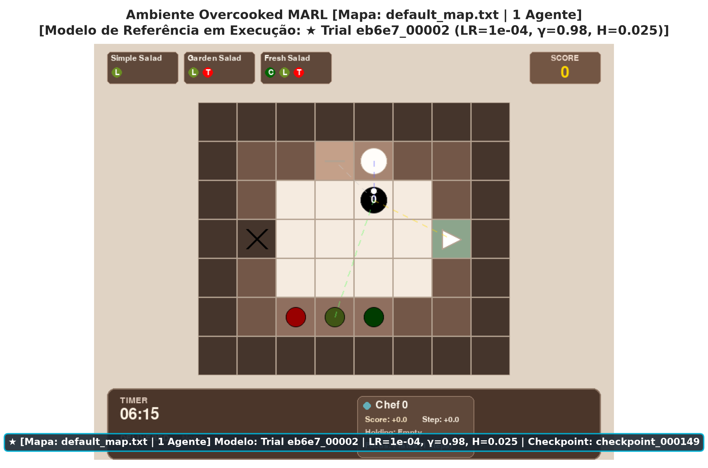
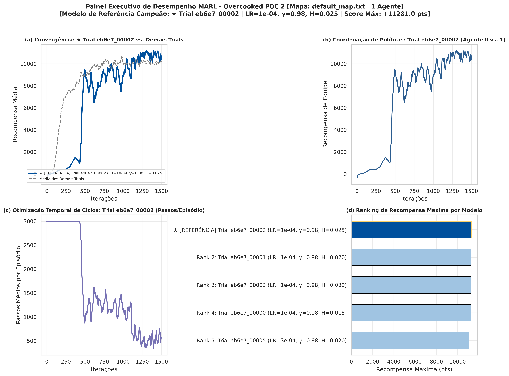
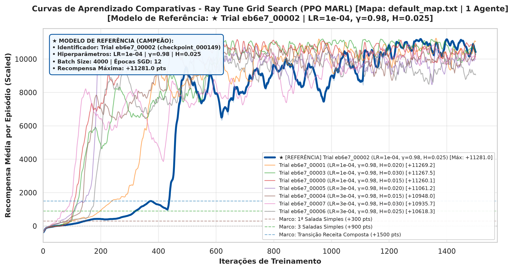
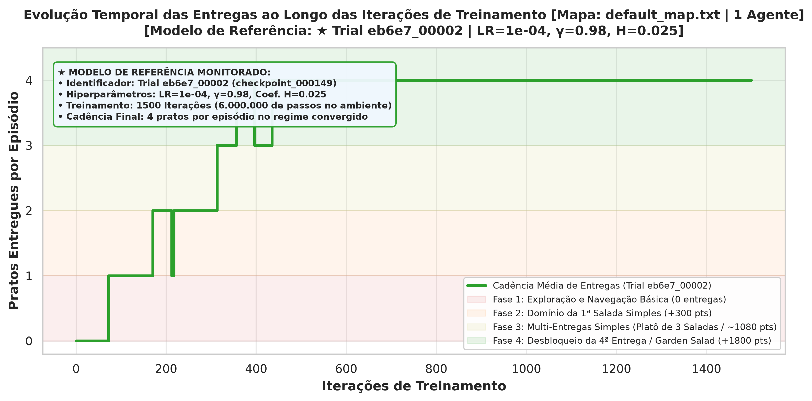

# 02 — 1-Agent Experiment (Open Kitchen Baseline)

Baseline validation of the **150D featurized observation space** and **Potential-Based Reward Shaping (PBRS)** with a single agent in `default_map.txt`.

---

* **Champion Model:** `Trial eb6e7_00002` (`LR = 1e-4`, `γ = 0.98`, `Entropy = 0.025`) — **`+11,281.00 pts`** (**100%** of trials converged).

<table>
  <tr>
    <td align="center" width="50%">
      
    </td>
    <td align="center" width="50%">
      
    </td>
  </tr>
  <tr>
    <td align="center" width="50%">
      
    </td>
    <td align="center" width="50%">
      
    </td>
  </tr>
</table>

<b>All Plots in this Folder (14 files)</b>

* [`env_hud_default_map_1_agente.png`](./env_hud_default_map_1_agente.png) — Environment screenshot (`default_map.txt`).
* [`fig_executive_dashboard_2x2_default_map_1_agente.png`](./fig_executive_dashboard_2x2_default_map_1_agente.png) — 2x2 executive performance dashboard.
* [`learning_curves_tune_default_map_1_agente.png`](./learning_curves_tune_default_map_1_agente.png) — Grid search learning curves.
* [`hyperparameter_comparison_default_map_1_agente.png`](./hyperparameter_comparison_default_map_1_agente.png) — Learning rate vs. entropy heatmap.
* [`fig_radar_performance_profile_default_map_1_agente.png`](./fig_radar_performance_profile_default_map_1_agente.png) — Multi-criteria radar profile.
* [`fig_dishes_and_diversity_default_map_1_agente.png`](./fig_dishes_and_diversity_default_map_1_agente.png) — Delivered dishes count and recipe diversity.
* [`fig_reward_vs_deliveries_default_map_1_agente.png`](./fig_reward_vs_deliveries_default_map_1_agente.png) — Reward vs. deliveries linear correlation.
* [`fig_delivery_timeline_growth_default_map_1_agente.png`](./fig_delivery_timeline_growth_default_map_1_agente.png) — Delivery growth across training phases.
* [`fig_episode_efficiency_default_map_1_agente.png`](./fig_episode_efficiency_default_map_1_agente.png) — Episode duration and reward density.
* [`fig_idle_time_and_inactivity_default_map_1_agente.png`](./fig_idle_time_and_inactivity_default_map_1_agente.png) — Idle time reduction.
* [`fig_agent_workload_distribution_default_map_1_agente.png`](./fig_agent_workload_distribution_default_map_1_agente.png) — Action & task workload breakdown.
* [`pathologies_behavior_default_map_1_agente.png`](./pathologies_behavior_default_map_1_agente.png) — Behavioral consistency curve.
* [`fig_entropy_dynamics_default_map_1_agente.png`](./fig_entropy_dynamics_default_map_1_agente.png) — Policy entropy dynamics.
* [`fig_loss_convergence_default_map_1_agente.png`](./fig_loss_convergence_default_map_1_agente.png) — Actor and critic loss convergence.

---

⬅**[Back to Results Index](../README.md)**
