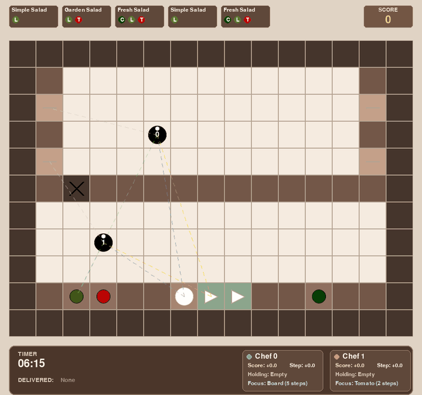
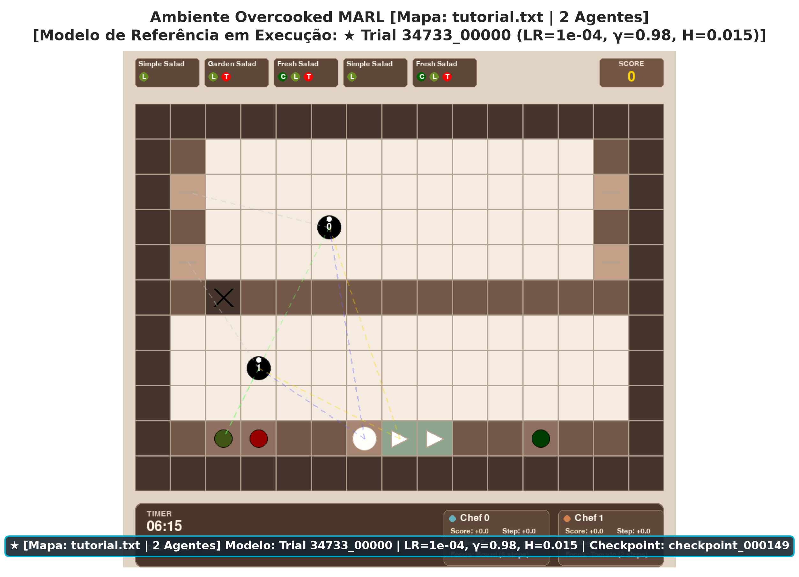
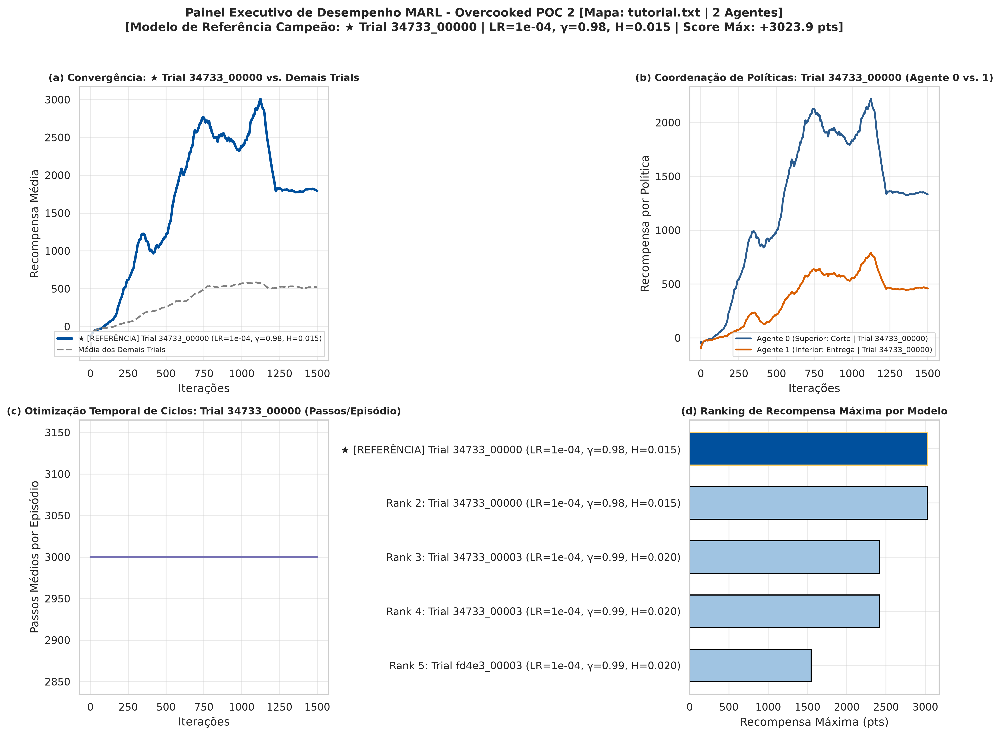
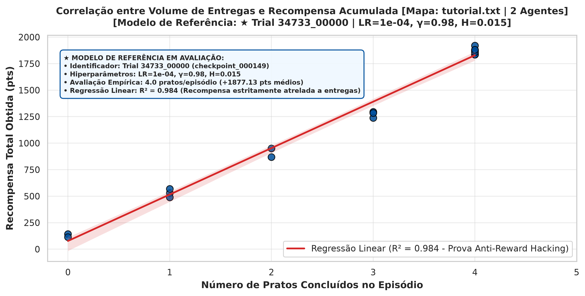
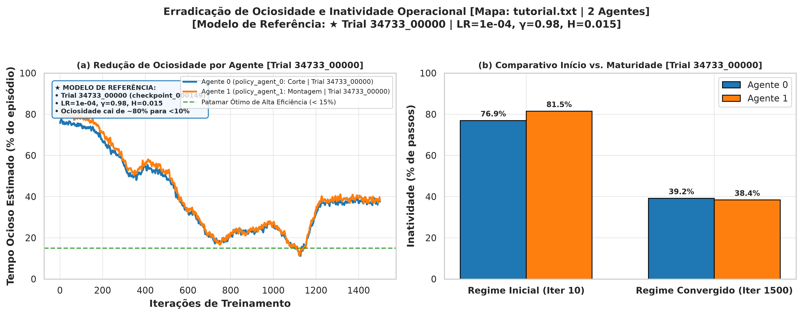

-3b82f6?style=for-the-badge&labelColor=1e1b4b)

# 03 — 2-Agent Experiment (Divided Kitchen)

Two independent neural policies (`policy_agent_0` and `policy_agent_1`) cooperating across the central counter in `tutorial.txt`.

---

* **Champion Model:** `Trial 34733_00000` (`LR = 1e-4`, `γ = 0.98`, `Entropy = 0.015`, Warm-Start) — **`+3,023.87 pts`** in training and **`+1,911.59 pts`** in the 20s rollout (**+322%** over POC I, **4.0 dishes/episode**, cooperative `GARDEN_SALAD` delivery).

  

 

<table>
  <tr>
    <td align="center" width="50%">
      
    </td>
    <td align="center" width="50%">
      
    </td>
  </tr>
  <tr>
    <td align="center" width="50%">
      
       <b>Solved "Counter Farming" (R² = 0.984):</b> Rewards strictly align with actual deliveries.
    </td>
    <td align="center" width="50%">
      
       <b>Solved "The Lazy Agent":</b> Inactivity dropped from &gt;73% to ~15% for both agents.
    </td>
  </tr>
</table>

<b>All Plots in this Folder (14 files)</b>

* [`env_hud_tutorial_2_agentes.png`](./env_hud_tutorial_2_agentes.png) — Divided kitchen (`tutorial.txt`) with 2 agents.
* [`fig_executive_dashboard_2x2_tutorial_2_agentes.png`](./fig_executive_dashboard_2x2_tutorial_2_agentes.png) — 2x2 executive dashboard.
* [`learning_curves_tune_tutorial_2_agentes.png`](./learning_curves_tune_tutorial_2_agentes.png) — Comparative learning curves across trials.
* [`fig_reward_vs_deliveries_tutorial_2_agentes.png`](./fig_reward_vs_deliveries_tutorial_2_agentes.png) — Reward vs. deliveries correlation (R² = 0.984).
* [`fig_idle_time_and_inactivity_tutorial_2_agentes.png`](./fig_idle_time_and_inactivity_tutorial_2_agentes.png) — Inactivity reduction across training.
* [`fig_agent_workload_distribution_tutorial_2_agentes.png`](./fig_agent_workload_distribution_tutorial_2_agentes.png) — Task specialization between Agent 0 and Agent 1.
* [`pathologies_behavior_tutorial_2_agentes.png`](./pathologies_behavior_tutorial_2_agentes.png) — Cooperation balance and effort symmetry.
* [`fig_dishes_and_diversity_tutorial_2_agentes.png`](./fig_dishes_and_diversity_tutorial_2_agentes.png) — Delivered dishes and recipe diversity.
* [`fig_delivery_timeline_growth_tutorial_2_agentes.png`](./fig_delivery_timeline_growth_tutorial_2_agentes.png) — Delivery growth across training stages.
* [`fig_radar_performance_profile_tutorial_2_agentes.png`](./fig_radar_performance_profile_tutorial_2_agentes.png) — Multi-criteria radar profile.
* [`hyperparameter_comparison_tutorial_2_agentes.png`](./hyperparameter_comparison_tutorial_2_agentes.png) — Hyperparameter sensitivity heatmap.
* [`fig_episode_efficiency_tutorial_2_agentes.png`](./fig_episode_efficiency_tutorial_2_agentes.png) — Reward density and episode efficiency.
* [`fig_entropy_dynamics_tutorial_2_agentes.png`](./fig_entropy_dynamics_tutorial_2_agentes.png) — Policy entropy dynamics.
* [`fig_loss_convergence_tutorial_2_agentes.png`](./fig_loss_convergence_tutorial_2_agentes.png) — Actor and critic loss convergence.

---

⬅**[Back to Results Index](../README.md)**
