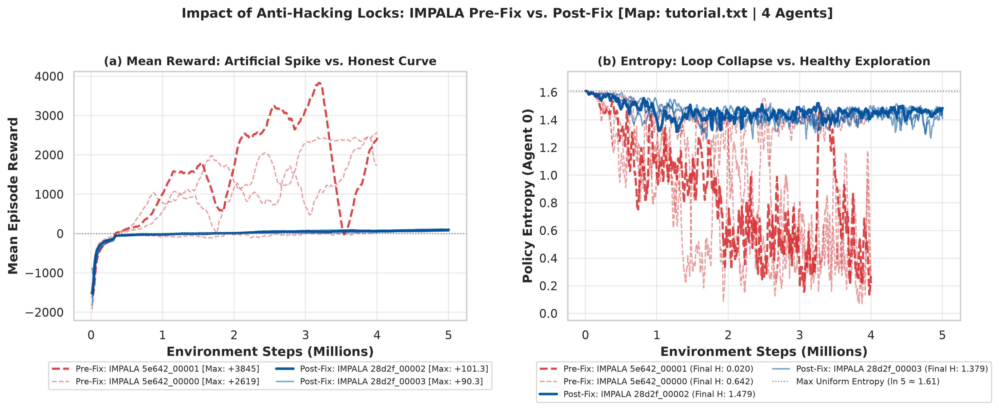
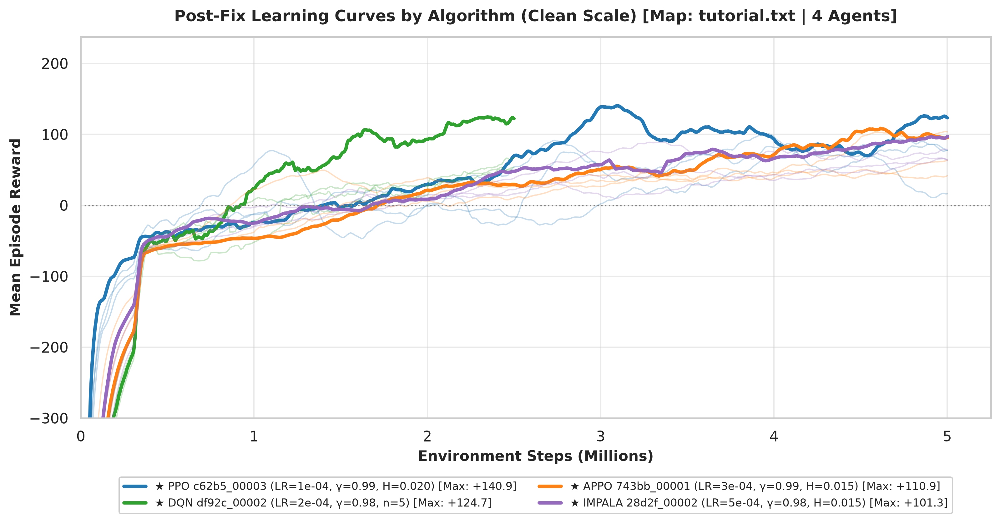
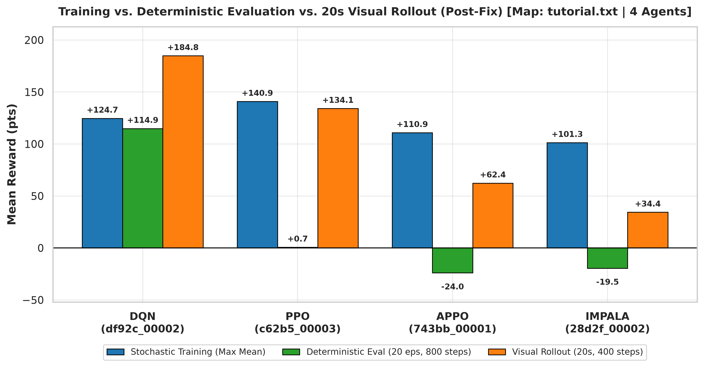
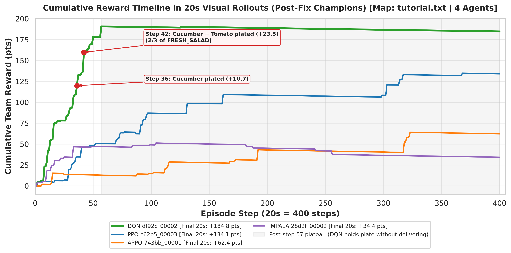
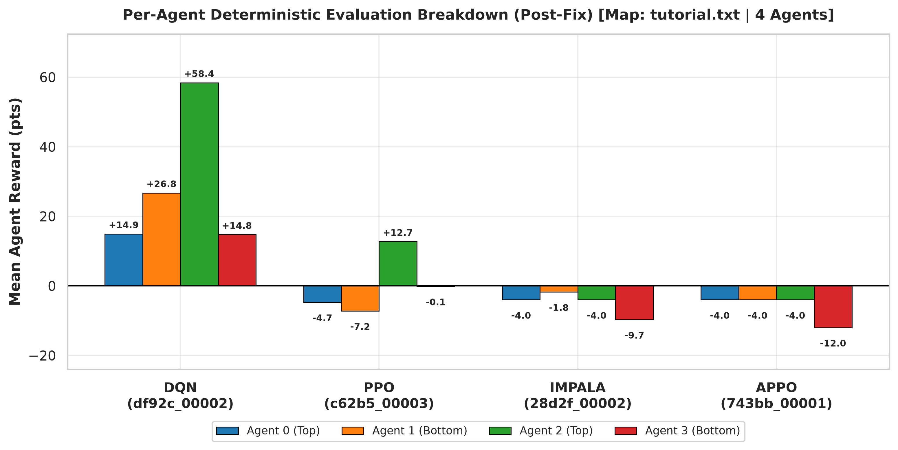
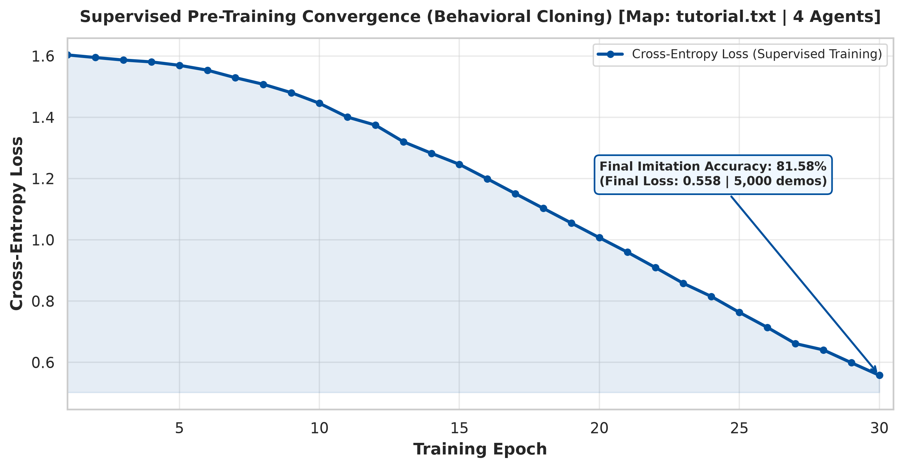

-2ca02c?style=for-the-badge&labelColor=1e1b4b)
-3b82f6?style=for-the-badge&labelColor=1e1b4b)

# 04 — 4-Agent Brigade & Multi-Algorithm Benchmark

Four independent policies operating simultaneously in `tutorial.txt` (2 chopping in the top zone, 2 fetching/plating/delivering in the bottom zone), comparing **IMPALA**, **APPO**, **DQN/Rainbow**, **PPO**, and **Behavioral Cloning (BC)** before and after stage-level anti-hacking locks.

---

* **Best Post-Fix Overall (Eval & Visual Rollout):** `DQN df92c_00002` (`LR = 2e-4`, `γ = 0.98`, `n-step = 5`, `2.5M steps`) — **`+124.66` train**, **`+114.87` deterministic eval**, and **`+184.80` in 20s** (only model to combine 2 ingredients onto a plate: `cucumber + tomato`).
* **Highest Post-Fix Training Mean:** `PPO c62b5_00003` (`LR = 1e-4`, `γ = 0.99`, `H = 0.02`, `5.0M steps`) — **`+140.88` train** (episode peak `+443.67`).
* **Highest Single-Episode Peak (Post-Fix):** `APPO 743bb_00003` (`LR = 5e-4`, `γ = 0.99`) — **`+512.47` single-episode peak**.
* **Anti-Hacking Verification:** Pre-fix `IMPALA 5e642_00001` reached `+3,845.34` via shaping loops (with entropy collapsing to `0.020` and `-16.00` eval); post-fix `IMPALA 28d2f_00002` eliminated all loops (`+101.32` honest train, `H = 1.479`).

  

 

<table>
  <tr>
    <td align="center" width="50%">
      
       <b>Anti-Hacking Proof:</b> IMPALA reward &amp; entropy before vs. after stage locks.
    </td>
    <td align="center" width="50%">
      
       <b>Clean-Scale Post-Fix Curves:</b> DQN hits <code>+124.7</code> in half the steps (2.5M vs. 5M).
    </td>
  </tr>
  <tr>
    <td align="center" width="50%">
      
       <b>Transfer Gap:</b> DQN preserves greedy eval performance; PG methods drop under <code>argmax</code>.
    </td>
    <td align="center" width="50%">
      
       <b>20s Rollout Timeline:</b> DQN plates cucumber (step 36) + tomato (step 42), then plateaus after step 57.
    </td>
  </tr>
  <tr>
    <td align="center" width="50%">
      
       <b>Per-Agent Breakdown:</b> All 4 agents positive in DQN (<code>agent_2 = +58.4</code>).
    </td>
    <td align="center" width="50%">
      
       <b>Behavioral Cloning:</b> Cross-entropy loss drops <code>1.603 → 0.558</code> (<code>81.58%</code> accuracy).
    </td>
  </tr>
</table>

<b>All Plots in this Folder (26 files)</b>

* [`fig_antihacking_before_after_tutorial_4_agentes.png`](./fig_antihacking_before_after_tutorial_4_agentes.png) — IMPALA reward &amp; entropy comparison before vs. after anti-hacking locks.
* [`fig_postfix_learning_curves_by_algo_tutorial_4_agentes.png`](./fig_postfix_learning_curves_by_algo_tutorial_4_agentes.png) — Clean-scale post-fix learning curves by algorithm (PPO, DQN, APPO, IMPALA) over environment steps.
* [`fig_train_vs_eval_vs_visual_gap_tutorial_4_agentes.png`](./fig_train_vs_eval_vs_visual_gap_tutorial_4_agentes.png) — Stochastic training vs. deterministic evaluation vs. 20s visual rollout comparison.
* [`fig_eval_agent_breakdown_by_algo_tutorial_4_agentes.png`](./fig_eval_agent_breakdown_by_algo_tutorial_4_agentes.png) — Individual deterministic evaluation reward per agent (`agent_0`–`agent_3`).
* [`fig_bc_training_curve_tutorial_4_agentes.png`](./fig_bc_training_curve_tutorial_4_agentes.png) — Behavioral Cloning supervised loss convergence over 30 epochs (`81.58%` imitation accuracy).
* [`fig_visual_rollout_20s_timeline_tutorial_4_agentes.png`](./fig_visual_rollout_20s_timeline_tutorial_4_agentes.png) — Step-by-step 20s rollout reward timeline highlighting DQN's 2-ingredient plating milestones.
* [`fig_reference_model_card_tutorial_4_agentes.png`](./fig_reference_model_card_tutorial_4_agentes.png) — Standalone reference model specification card.
* [`fig_convergence_best_vs_others_tutorial_4_agentes.png`](./fig_convergence_best_vs_others_tutorial_4_agentes.png) — Champion convergence vs. mean of all other models.
* [`fig_policy_coordination_tutorial_4_agentes.png`](./fig_policy_coordination_tutorial_4_agentes.png) — Policy coordination dynamics.
* [`fig_cycle_temporal_optimization_tutorial_4_agentes.png`](./fig_cycle_temporal_optimization_tutorial_4_agentes.png) — Episode step-length temporal optimization.
* [`fig_ranking_top_models_tutorial_4_agentes.png`](./fig_ranking_top_models_tutorial_4_agentes.png) — Top-10 model ranking by maximum training reward.
* [`env_hud_tutorial_4_agentes.png`](./env_hud_tutorial_4_agentes.png) — 4-agent simulator HUD in `tutorial.txt`.
* [`fig_algorithm_comparison_tutorial_4_agentes.png`](./fig_algorithm_comparison_tutorial_4_agentes.png) — Performance comparison across IMPALA, APPO, DQN, and PPO.
* [`fig_training_time_and_efficiency_tutorial_4_agentes.png`](./fig_training_time_and_efficiency_tutorial_4_agentes.png) — Training duration (hours) and sampling throughput (steps/s).
* [`fig_agent_workload_distribution_tutorial_4_agentes.png`](./fig_agent_workload_distribution_tutorial_4_agentes.png) — Emergent division of labor across the 4 chefs.
* [`fig_radar_performance_profile_tutorial_4_agentes.png`](./fig_radar_performance_profile_tutorial_4_agentes.png) — Multi-criteria radar comparison of top models.
* [`learning_curves_tune_tutorial_4_agentes.png`](./learning_curves_tune_tutorial_4_agentes.png) — Full learning curves for all 20 benchmark models (legend below chart).
* [`fig_dishes_and_diversity_tutorial_4_agentes.png`](./fig_dishes_and_diversity_tutorial_4_agentes.png) — Delivered dishes and recipe diversity.
* [`fig_reward_vs_deliveries_tutorial_4_agentes.png`](./fig_reward_vs_deliveries_tutorial_4_agentes.png) — Reward vs. deliveries correlation.
* [`fig_idle_time_and_inactivity_tutorial_4_agentes.png`](./fig_idle_time_and_inactivity_tutorial_4_agentes.png) — Idle time analysis.
* [`fig_delivery_timeline_growth_tutorial_4_agentes.png`](./fig_delivery_timeline_growth_tutorial_4_agentes.png) — Delivery progression across training phases.
* [`pathologies_behavior_tutorial_4_agentes.png`](./pathologies_behavior_tutorial_4_agentes.png) — Team cooperation balance.
* [`hyperparameter_comparison_tutorial_4_agentes.png`](./hyperparameter_comparison_tutorial_4_agentes.png) — Hyperparameter sensitivity analysis.
* [`fig_episode_efficiency_tutorial_4_agentes.png`](./fig_episode_efficiency_tutorial_4_agentes.png) — Episode efficiency and reward density.
* [`fig_entropy_dynamics_tutorial_4_agentes.png`](./fig_entropy_dynamics_tutorial_4_agentes.png) — Policy entropy dynamics.
* [`fig_loss_convergence_tutorial_4_agentes.png`](./fig_loss_convergence_tutorial_4_agentes.png) — Gradient and loss convergence.

---

⬅**[Back to Results Index](../README.md)**
