

  

# Experiment Results & Analyses

This document centralizes all visual results, learning curves, multi-algorithm benchmarks, and behavioral diagnostics for the **Overcooked MARL Environment**, organized progressively from environment evolution to 1-, 2-, and 4-agent experiments.

---

## Summary

Across iterative architecture, reward-shaping, and training cycles, the experimental progression followed four main stages:

1. **Architecture & Observation Evolution (POC I → POC II):** Replacing the spatial 9-channel CNN observation with a scale-invariant **150D featurized vector** (MLP `[256, 256]`) and refactoring stations into the Strategy pattern reduced inference latency by **88.6%** (`18.4 ms → 2.1 ms/step`) while enabling 1 to 4 agents on arbitrary layouts.
2. **1-Agent Open Kitchen Baseline (`default_map.txt`):** All 8 PPO trials converged cleanly above `+8,960` final points, peaking at **`+11,281.00 pts`** (`Trial eb6e7_00002`), validating the 150D observation space and Potential-Based Reward Shaping (PBRS).
3. **2-Agent Cooperation in Divided Kitchen (`tutorial.txt`):** Introducing independent neural policies (`policy_agent_0`, `policy_agent_1`), symmetric handoff credit, and warm-start refinement resolved *Counter Farming* ($R^2 = 0.984$) and *The Lazy Agent* (inactivity reduced from `>73%` to `~15%`), reaching **`+3,023.87 pts`** in training and **`+1,911.59 pts`** in the 20s visual rollout (**`+322%`** over POC I, **4.0 dishes/episode**, including cooperative `GARDEN_SALAD`).
4. **4-Agent Multi-Algorithm Benchmark & Anti-Hacking Validation (`tutorial.txt`):**
   * **Pre-Fix Diagnosis:** Asynchronous V-Trace architectures (`IMPALA`, `APPO`) achieved **5x–7x higher throughput** than synchronous `PPO` and `DQN`, but visual inspection exposed shaping exploits (`+3,845` to `+3,990` training scores with `0` deliveries and entropy collapsing near `0.02`).
   * **Post-Fix 3-Day Benchmark (17 models):** Adding stage-level locks (`place_stages_awarded`, `pickup_ready_awarded`, `place_on_station_awarded`) eradicated reward hacking completely (honest training means `+50.9` to `+140.9`, healthy entropy `0.96–1.50`):
     * **DQN (`df92c_00002`, 2.5M steps):** Best overall reliability and sample efficiency — `+124.66` training mean, the **only model to preserve greedy deterministic evaluation (`+114.87`, all 4 agents positive)**, and **`+184.80`** in the 20s rollout (only model to combine 2 ingredients — `cucumber + tomato`, 2/3 of `FRESH_SALAD` — onto a single plate).
     * **PPO (`c62b5_00003`, 5.0M steps):** Highest post-fix training mean (`+140.88`, episode peak `+443.67`); **APPO (`743bb_00003`)** reached the highest single-episode peak (`+512.47`); **IMPALA (`28d2f_00002`)** led throughput (`+101.32` in ~5.85h). All three policy-gradient families kept high final entropy (`H = 1.17–1.48`), degrading under deterministic `argmax`.
     * **Behavioral Cloning (`BC`):** Smooth supervised convergence over 30 epochs (`1.603 → 0.558` loss, **`81.58%` imitation accuracy**).
   * **Next Optimization (In Progress):** Replay of `DQN df92c_00002` linked the post-step-57 plateau to early epsilon decay (`150k` steps, 6% of training) and a `100k` buffer; `train_dqn.py` was recalibrated to `1.5M` exploration steps (`final_epsilon = 0.05`), a `300k` buffer, and `5M–8M` step budgets.

### Quick Navigation

| Section | Folder | Scope |
| :--- | :--- | :--- |
| [1. Overview & Environment Evolution](#1-overview--environment-evolution) | [`01_visao_geral_e_evolucao/`](./01_visao_geral_e_evolucao/) | POC I vs. POC II architecture, cross-scale & global comparisons |
| [2. 1-Agent Open Kitchen Baseline](#2-1-agent-open-kitchen-baseline) | [`02_experimento_1_agente_cozinha_aberta/`](./02_experimento_1_agente_cozinha_aberta/) | Single-agent validation on `default_map.txt` |
| [3. 2-Agent Divided Kitchen Cooperation](#3-2-agent-divided-kitchen-cooperation) | [`03_experimento_2_agentes_cooperacao/`](./03_experimento_2_agentes_cooperacao/) | Independent policies & handoff coordination on `tutorial.txt` |
| [4. 4-Agent Brigade & Multi-Algorithm Benchmark](#4-4-agent-brigade--multi-algorithm-benchmark) | [`04_experimento_4_agentes_e_algoritmos/`](./04_experimento_4_agentes_e_algoritmos/) | Full 5-algorithm benchmark (`IMPALA`, `APPO`, `DQN`, `PPO`, `BC`) & diagnostics |

*Charts are automatically regenerated by [`experiments/analysis/generate_report_charts.py`](../experiments/analysis/generate_report_charts.py). Each plot below includes a general interpretation guide so it remains valid across future runs.*

---

## Gameplay Previews

<table>
  <tr>
    <th align="center">2-Agent Cooperation (<code>tutorial.txt</code>)</th>
    <th align="center">4-Agent Brigade (<code>tutorial.txt</code>)</th>
  </tr>
  <tr>
    <td align="center" width="50%">
      
    </td>
    <td align="center" width="50%">
      
    </td>
  </tr>
</table>

---

## 1. Overview & Environment Evolution

### Architecture Evolution (POC I vs. POC II)

  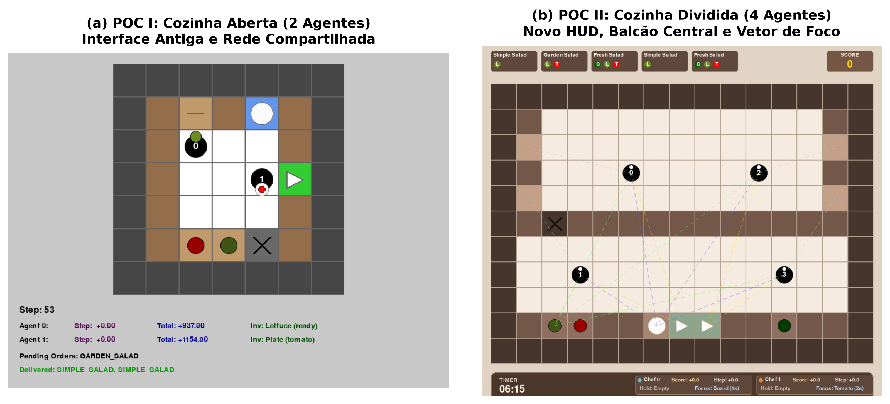

> **How to interpret:** Side-by-side comparison showing the evolution from the initial open kitchen + CNN prototype (POC I) to the divided multi-agent kitchen with a 150D featurized observation space, live order HUD, and directional beacons (POC II).

### Global Performance Comparison

  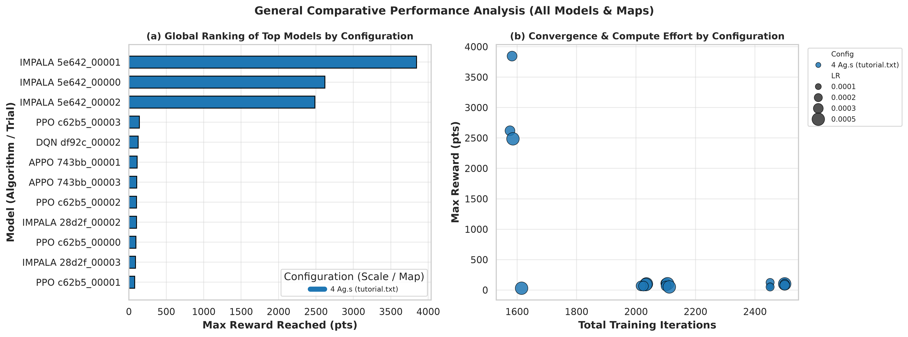

> **How to interpret:** Left panel ranks top models globally by maximum training reward across configurations; right panel plots max reward versus total training iterations, highlighting the trade-off between compute effort and return.

### Multi-Agent Scalability Comparison

  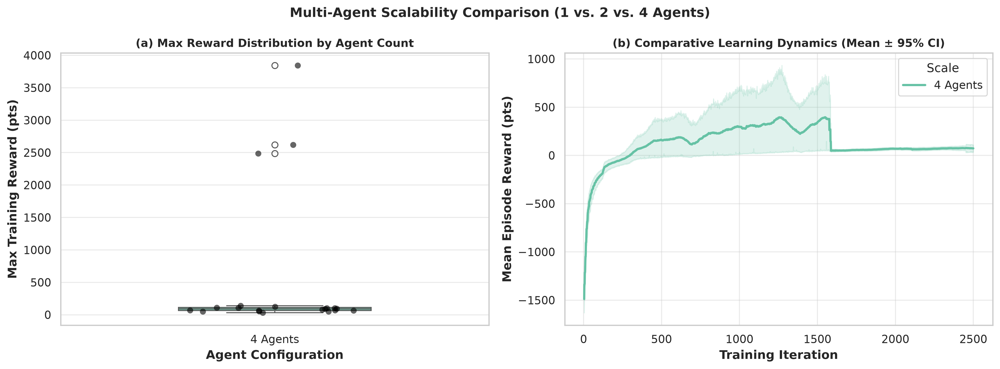

> **How to interpret:** Compares reward distributions (left) and aggregate learning dynamics (right) as team size scales from 1 to 2 and 4 agents, illustrating the increasing coordination complexity.

### Global Hyperparameter Landscape

  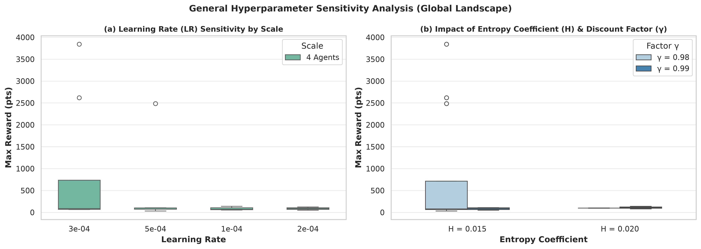

> **How to interpret:** Aggregates maximum reward distributions across learning rates (left) and entropy/discount combinations (right) to reveal which hyperparameter regions generalize best across scales.

---

## 2. 1-Agent Open Kitchen Baseline

Baseline validation of the 150D observation space and PBRS reward shaping with a single agent in `default_map.txt`.

### Simulator HUD & Learning Curves (1 Agent)
<table>
  <tr>
    <td align="center" width="46%">
      
       Open kitchen layout (<code>default_map.txt</code>) with direct access to all stations.
    </td>
    <td align="center" width="54%">
      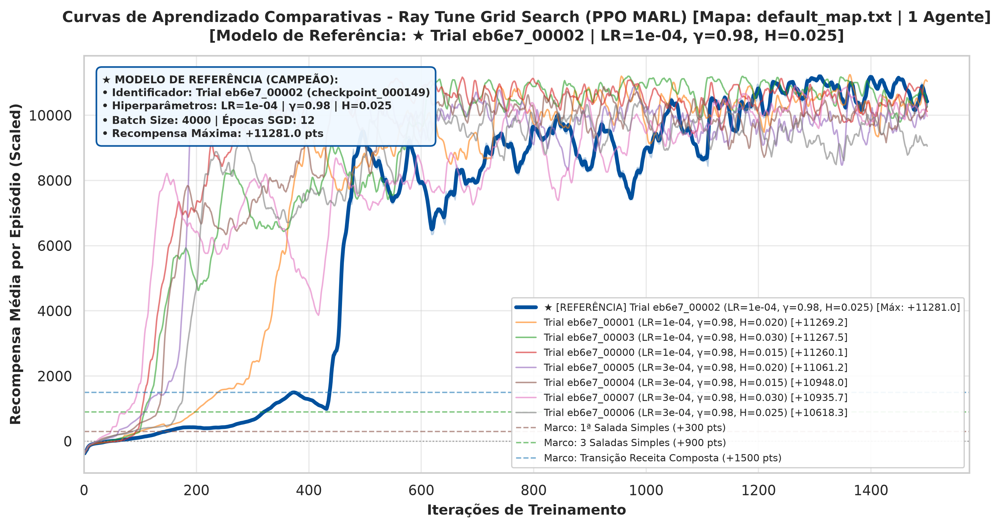
       Smoothed reward progression across all single-agent PPO grid search trials.
    </td>
  </tr>
</table>

### Delivery Growth & Reward Alignment (1 Agent)
<table>
  <tr>
    <td align="center" width="50%">
      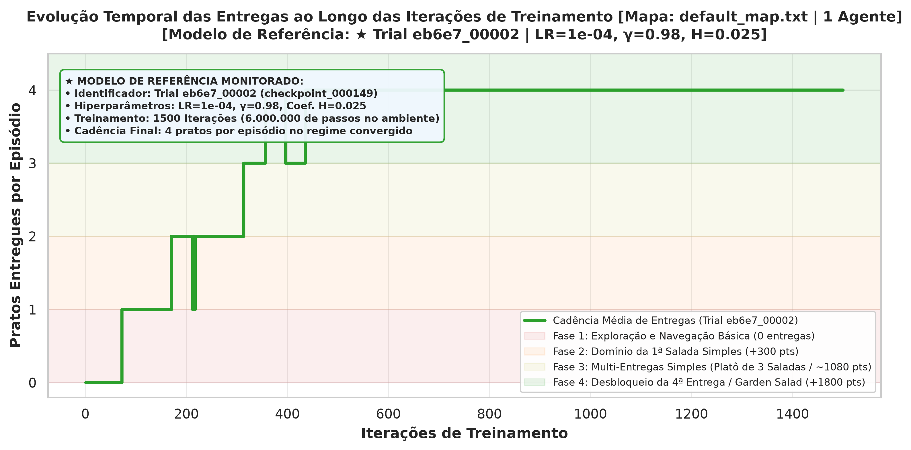
       Progression of completed deliveries per episode across training phases.
    </td>
    <td align="center" width="50%">
      
       Linear correlation verifying that higher episode rewards directly reflect completed dishes.
    </td>
  </tr>
</table>

---

## 3. 2-Agent Divided Kitchen Cooperation

Two independent neural policies (`policy_agent_0` and `policy_agent_1`) cooperating across the central dividing counter in `tutorial.txt`.

### Simulator HUD & Learning Curves (2 Agents)
<table>
  <tr>
    <td align="center" width="46%">
      
       Divided kitchen (<code>tutorial.txt</code>) requiring counter handoffs between top and bottom zones.
    </td>
    <td align="center" width="54%">
      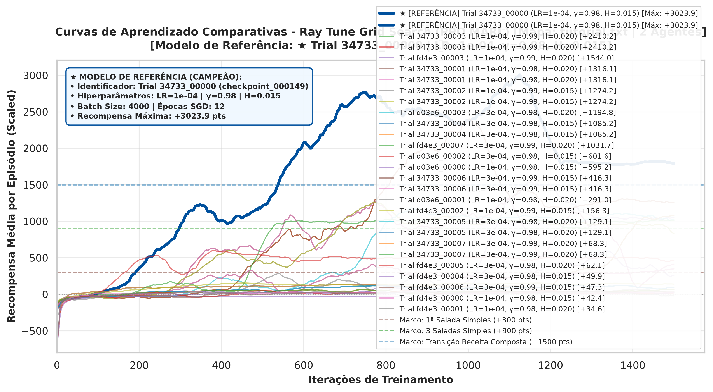
       Comparative learning curves across independent-policy PPO trials.
    </td>
  </tr>
</table>

### Behavioral Pathologies Solved (2 Agents)
<table>
  <tr>
    <td align="center" width="50%">
      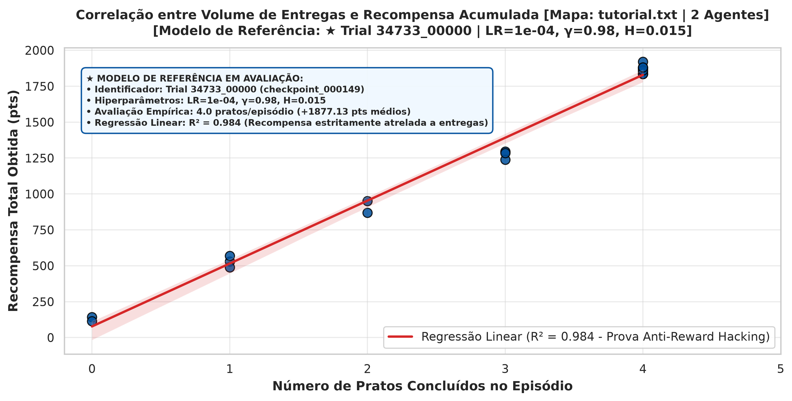
       <b>Anti-Counter Farming:</b> Strong linear alignment between cumulative reward and actual deliveries.
    </td>
    <td align="center" width="50%">
      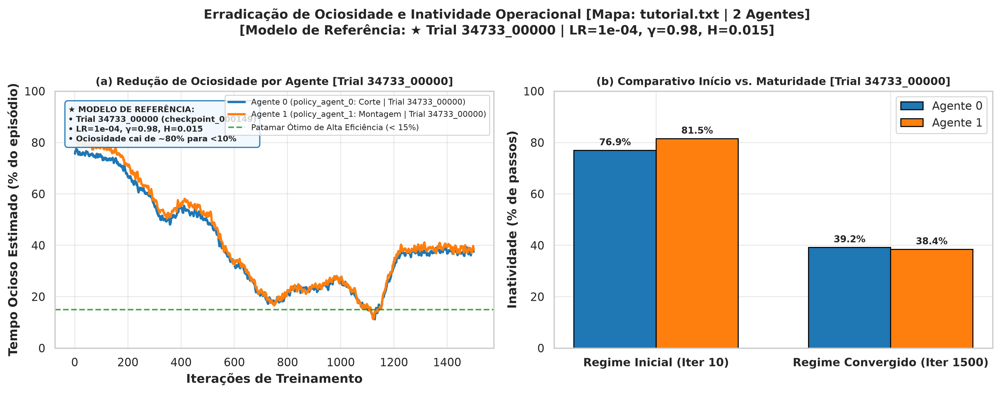
       <b>Anti-Lazy Agent:</b> Sharp reduction in inactivity across both zones as cooperative roles emerge.
    </td>
  </tr>
</table>

---

## 4. 4-Agent Brigade & Multi-Algorithm Benchmark

Four independent policies operating simultaneously in `tutorial.txt` (2 chopping in the top zone, 2 fetching/plating/delivering in the bottom zone), comparing **IMPALA**, **APPO**, **DQN/Rainbow**, **PPO**, and **Behavioral Cloning (BC)**.

### 4.1 Kitchen Layout & Reference Model

#### Simulator HUD

  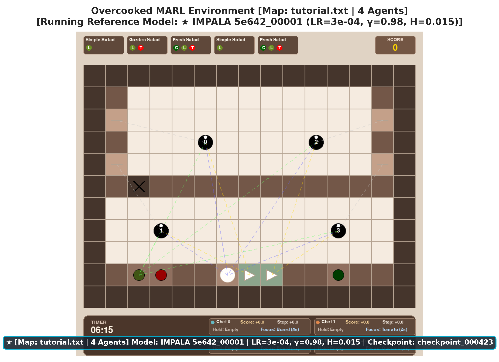

> **How to interpret:** Shows the spatial layout of `tutorial.txt` with all 4 agents active, highlighting the central dividing counter, cutting boards (`C`), ingredient and plate dispensers (`I`, `P`), delivery stations (`D`), and the live order queue HUD. Use this as a spatial reference when analyzing agent specialization and bottlenecks.

#### Reference Model Card

  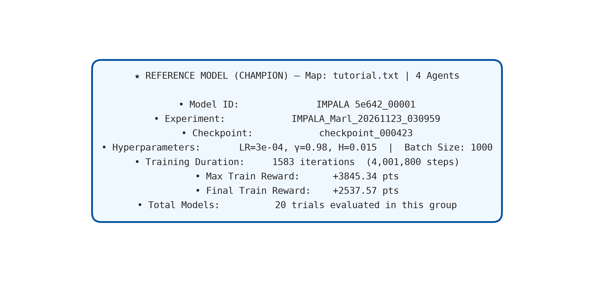

> **How to interpret:** Summarizes the top-ranked reference model (algorithm, trial ID, checkpoint, hyperparameters, total steps, and max/final training reward) that serves as the anchor for the diagnostic charts below.

### 4.2 Learning Progression & Multi-Algorithm Comparison

#### Full Comparative Learning Curves

  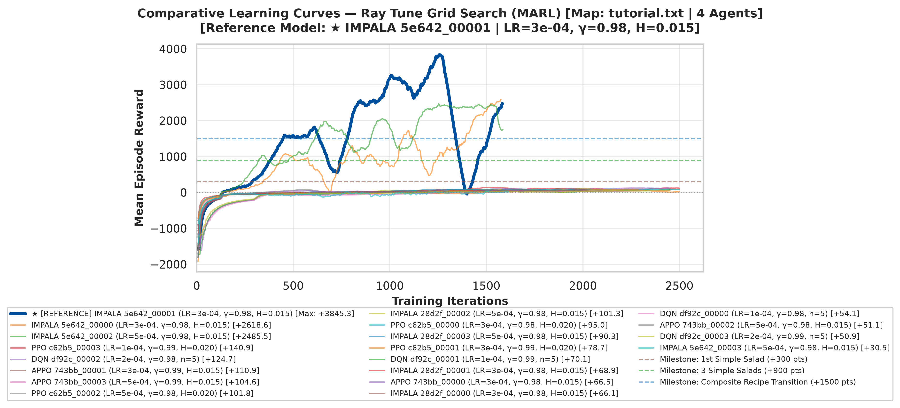

> **How to interpret:** Plots smoothed mean episode reward over training iterations for every loaded trial. A healthy run climbs steadily from negative initial step costs toward positive reward milestones. Abrupt vertical spikes followed by sudden crashes often indicate instability or reward-shaping loops rather than sustainable deliveries.

#### Clean-Scale Post-Fix Learning Curves

  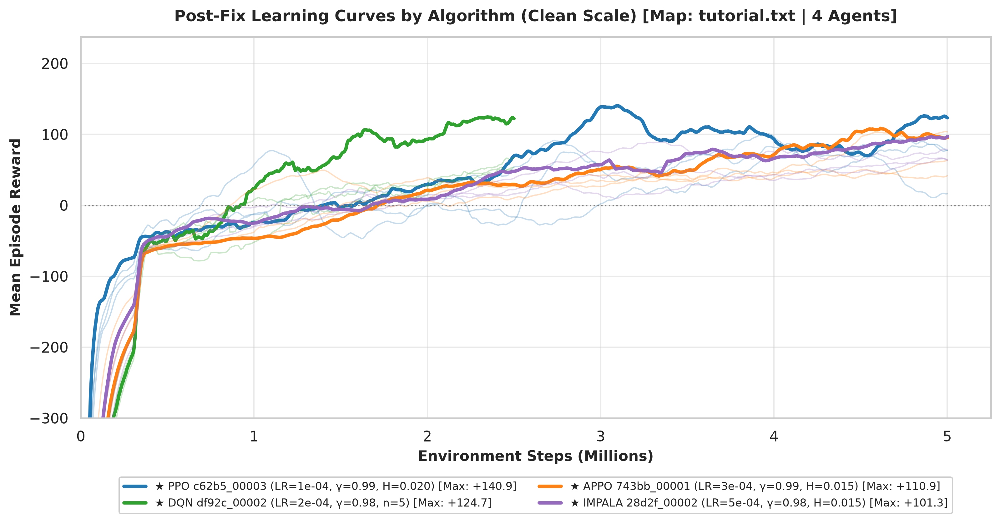

> **How to interpret:** Compares the champion of each algorithm family (bold lines) and remaining trials (faded lines) on a shared environment-steps axis (in millions), excluding pre-fix reward-hacking outliers. Steeper early slopes indicate higher sample efficiency; curves still rising at the right edge indicate the algorithm has not yet plateaued and benefits from longer training.

#### Reference Convergence vs. Mean of Other Models

  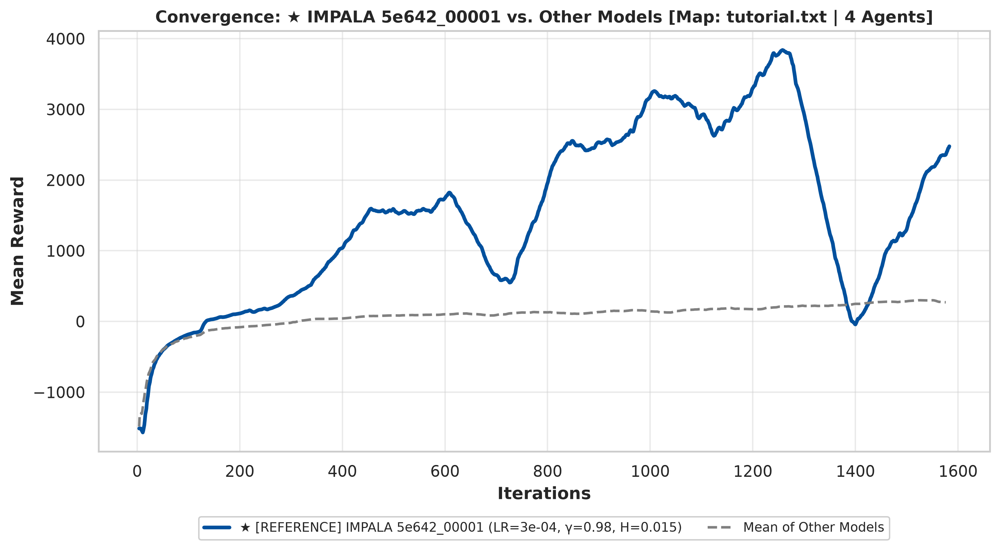

> **How to interpret:** Contrasts the reference model's reward curve against the average of all other models. A wide, sustained gap above the dashed mean shows strong sensitivity to hyperparameter or algorithm choice; overlapping curves indicate consistent performance across configurations.

#### Top-10 Model Ranking

  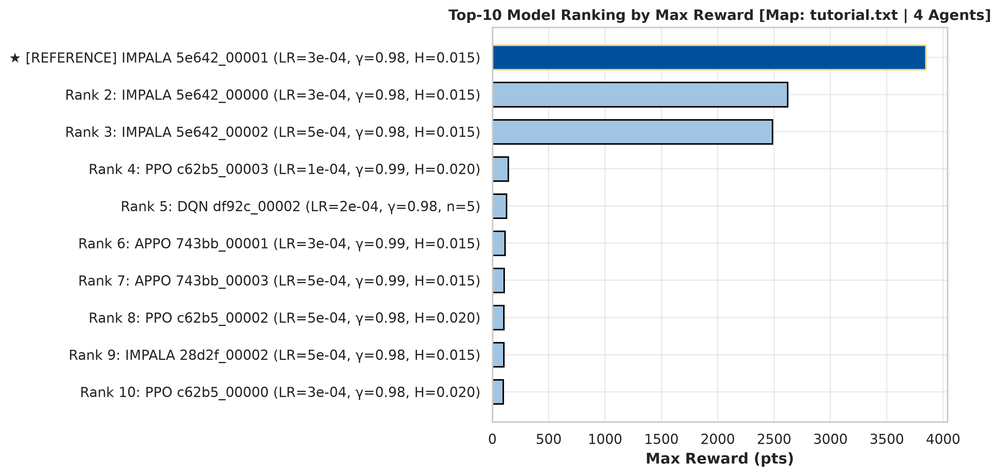

> **How to interpret:** Ranks the top trials by maximum training reward achieved. Always cross-check high training bars against deterministic evaluation and delivery charts to distinguish genuine task mastery from high-variance training spikes.

#### Algorithm Family Comparison

  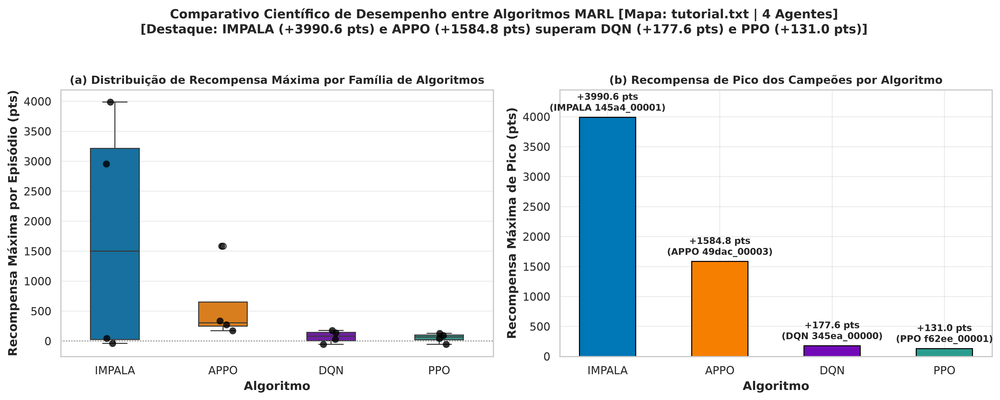

> **How to interpret:** Summarizes aggregate performance across RL algorithm families (`IMPALA`, `APPO`, `DQN`, `PPO`). Compare both peak performance and spread across trials to judge reliability versus best-case upside.

#### Training Time & Sampling Throughput

  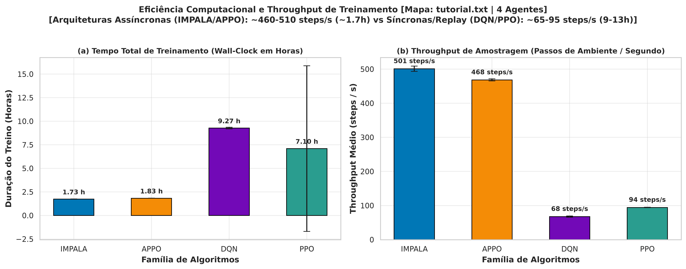

> **How to interpret:** Compares wall-clock training hours against environment sampling throughput (`steps/s`). Higher throughput (typically asynchronous actor-learner architectures like `IMPALA` and `APPO`) allows faster iteration over large step budgets, whereas slower off-policy methods (`DQN`) can compensate through replay-buffer sample reuse.

#### Multi-Criteria Performance Profile

  

> **How to interpret:** Projects the top models across five normalized axes (`Max Reward`, `Final Stability`, `Convergence Speed`, `Length Efficiency`, `Residual Exploration`). Larger, more balanced polygons indicate well-rounded policies; spiky polygons reveal trade-offs (e.g., high peak reward with low final stability).

#### Supervised Pre-Training Convergence (Behavioral Cloning)

  

> **How to interpret:** Tracks supervised cross-entropy loss across epochs when imitating demonstration trajectories. A smooth downward curve paired with high final imitation accuracy indicates the policy network can reliably clone expert actions for warm-starting RL.

### 4.3 Anti-Hacking Validation, Evaluation Gap & Deliveries

#### Anti-Hacking Impact: Pre-Fix vs. Post-Fix

  

> **How to interpret:** Side-by-side diagnostic of reward (left) and policy entropy (right) before and after stage-level anti-hacking locks. Reward hacking manifests as extreme reward spikes paired with sudden entropy collapse near zero; honest learning shows gradual reward growth while maintaining non-degenerate entropy.

#### Training vs. Deterministic Evaluation vs. 20s Visual Rollout

  

> **How to interpret:** Compares each algorithm's best stochastic training reward against its deterministic evaluation (`argmax`) and 20-second visual rollout. Similar bar heights signal robust generalization to greedy execution; a sharp drop in the deterministic evaluation bar indicates over-reliance on stochastic exploration or policy lockups.

#### 20s Visual Rollout Timeline

  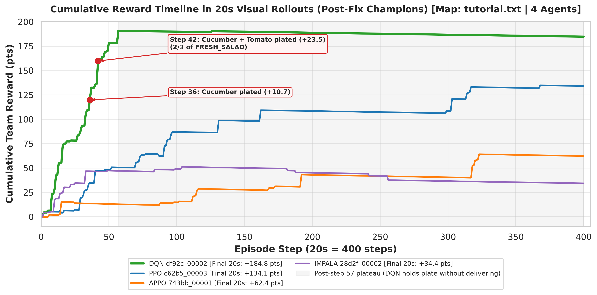

> **How to interpret:** Plots cumulative team reward step by step across a 400-step (20s) visual rollout. Steep upward jumps mark real task milestones (chopping, plating, combining ingredients, or deliveries), while flat or slightly downward plateaus reveal where agents stall or repeat unproductive actions.

#### Delivered Dish Volume & Recipe Diversity

  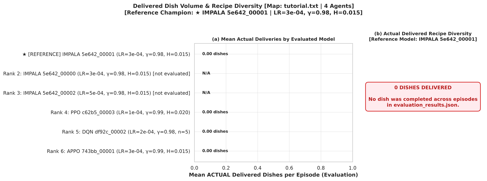

> **How to interpret:** Left panel shows actual mean dishes delivered per evaluation episode across models; right panel shows the breakdown of delivered recipe types (`SIMPLE_SALAD`, `GARDEN_SALAD`, `FRESH_SALAD`). Balanced slices across multi-ingredient recipes confirm true end-to-end kitchen mastery.

#### Correlation: Delivered Dishes vs. Cumulative Reward

  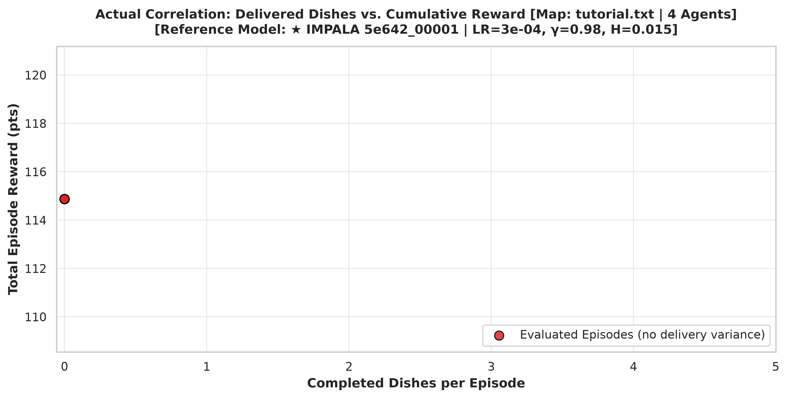

> **How to interpret:** Evaluates whether higher episode rewards genuinely correspond to more completed deliveries. A strong positive linear trend ($R^2 \to 1$) validates reward alignment; high positive rewards clustered at `0` deliveries warn that intermediate shaping still dominates the objective.

#### Delivery Timeline Growth

  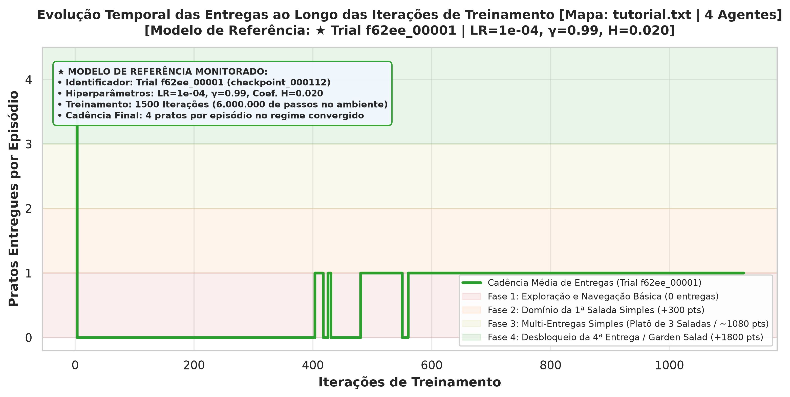

> **How to interpret:** Tracks how the average number of completed deliveries per episode evolves over training phases. Upward steps reflect the emergence of increasingly reliable preparation and handoff pipelines.

### 4.4 Team Coordination & Per-Agent Workload

#### Per-Agent Deterministic Evaluation Breakdown

  

> **How to interpret:** Breaks down deterministic evaluation reward across each individual chef (`agent_0`–`agent_3`) per algorithm. Positive bars across all four agents indicate active team-wide participation; negative bars pinpoint agents that remain idle, collide, or accumulate step penalties.

#### Agent Workload Distribution

  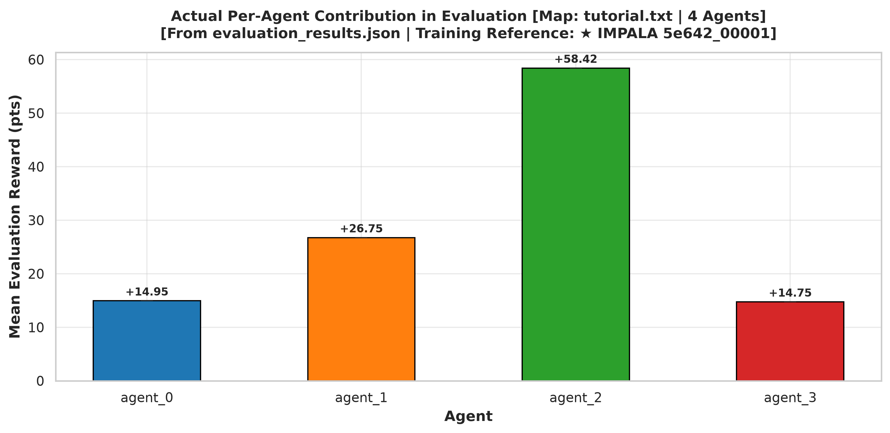

> **How to interpret:** Displays mean evaluation reward (with standard deviation error bars) for each agent in the latest `evaluation_results.json`. Comparing bar magnitudes reveals whether the team developed balanced division of labor or concentrated effort in a single agent.

#### Policy Coordination Dynamics

  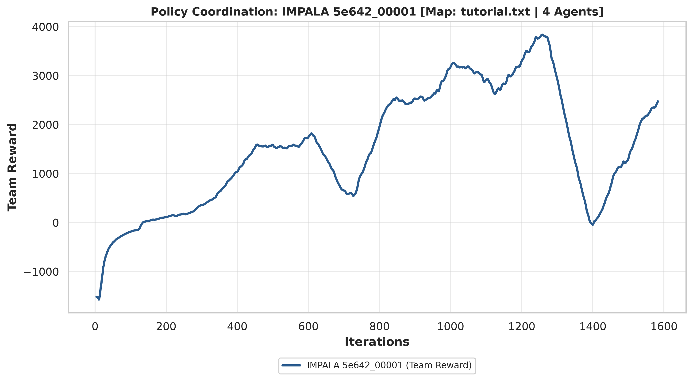

> **How to interpret:** Tracks how independent agent policies co-evolve over training iterations. Parallel upward trajectories indicate synchronized cooperation across kitchen zones, whereas diverging curves point to asymmetric credit assignment or non-stationarity.

#### Behavioral Coordination & Effort Symmetry

  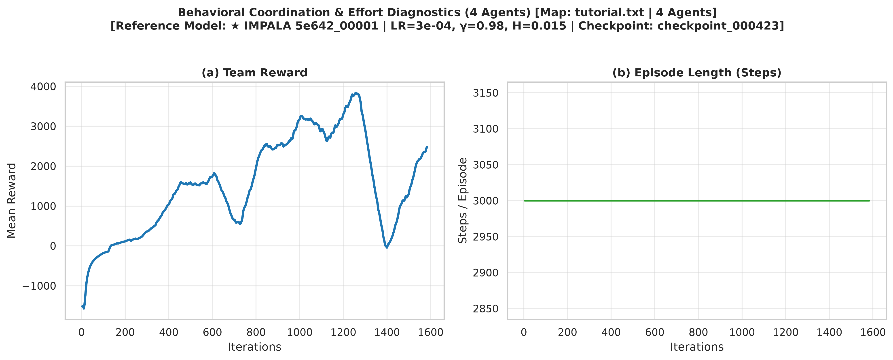

> **How to interpret:** Diagnoses classic multi-agent pathologies such as the *Lazy Agent* problem. When per-policy rewards are logged, staying near the `40%–60%` symmetry band confirms balanced effort; otherwise, it pairs team reward with episode step length to track overall progression.

#### Idle Time & Inactivity

  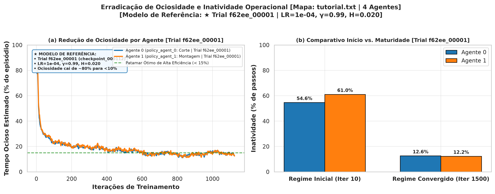

> **How to interpret:** Measures agent inactivity over training when idle-time telemetry is recorded. Decreasing inactivity curves indicate that agents learn to continuously engage in productive subtasks rather than waiting or oscillating.

### 4.5 Training Stability, Efficiency & Hyperparameter Sensitivity

#### Hyperparameter Sensitivity Analysis

  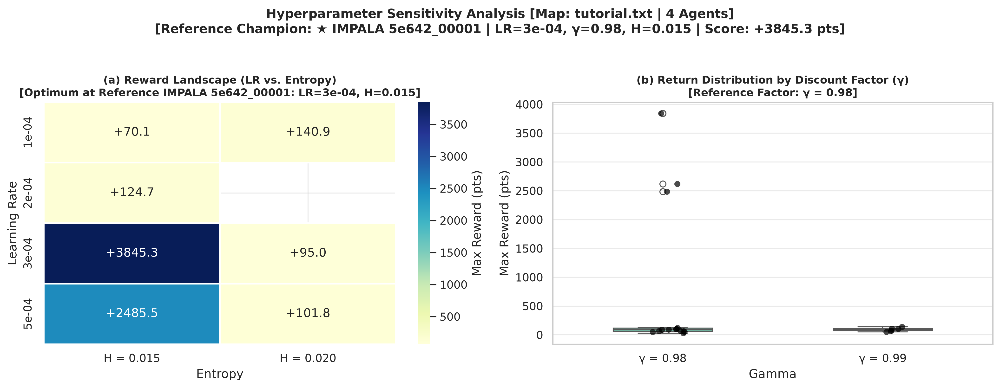

> **How to interpret:** Left heatmap maps maximum reward across `Learning Rate` vs. `Entropy Coefficient` (darker cells = higher reward); right boxplot compares return distributions by discount factor ($\gamma$). Use this to identify stable hyperparameter regions and whether longer-horizon credit assignment ($\gamma = 0.99$) outperforms shorter horizons ($\gamma = 0.98$).

#### Episode Efficiency & Reward Density

  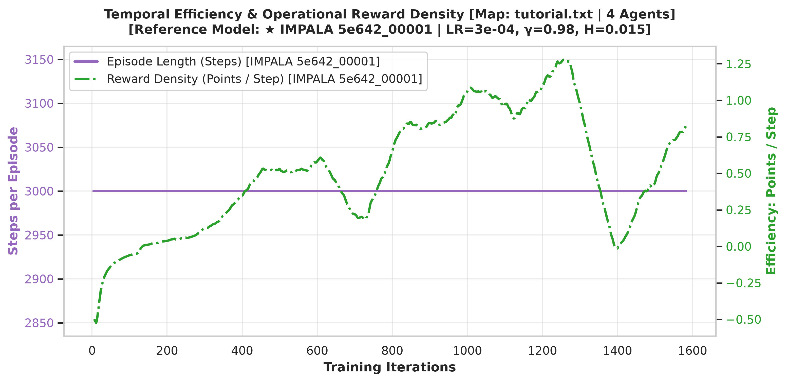

> **How to interpret:** Dual-axis plot pairing episode length (left axis, steps) with reward density (right axis, points/step). Rising reward density means agents accomplish more productive actions per step; falling episode length occurs once teams finish the entire order queue before the step limit.

#### Cycle Temporal Optimization

  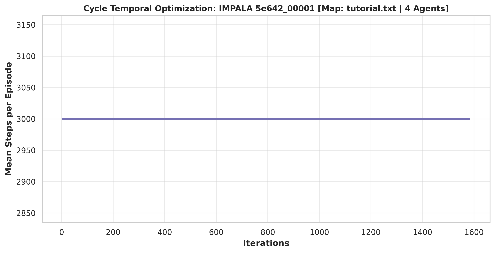

> **How to interpret:** Tracks mean steps per episode across training iterations. A flat line at the episode cap indicates episodes always end by timeout; a downward slope confirms that agents are completing all pending orders faster over time.

#### Policy Entropy Dynamics

  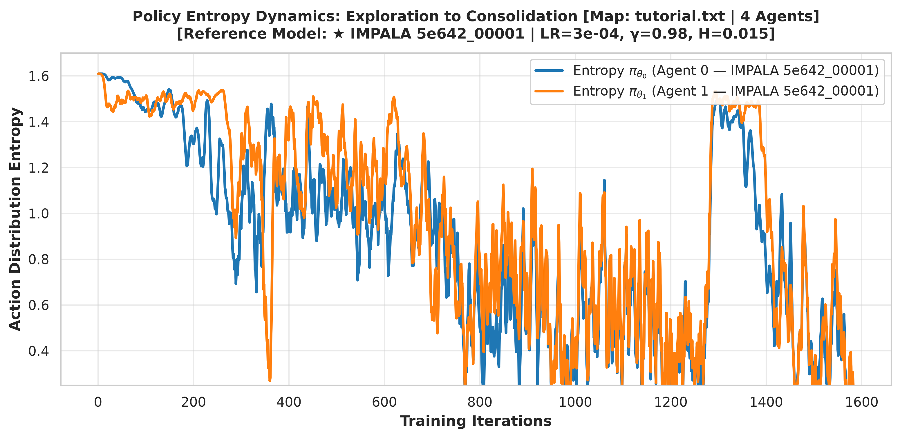

> **How to interpret:** Tracks action-distribution entropy over iterations (maximum uniform entropy for 5 discrete actions is $\ln 5 \approx 1.61$). Ideal learning starts near `1.61` and decays smoothly as policies become confident; entropy stuck near `1.4–1.6` indicates under-converged, overly random policies, while an abrupt drop near `0.0` warns of premature collapse into a fixed loop.

#### Gradient Stability & Loss Convergence

  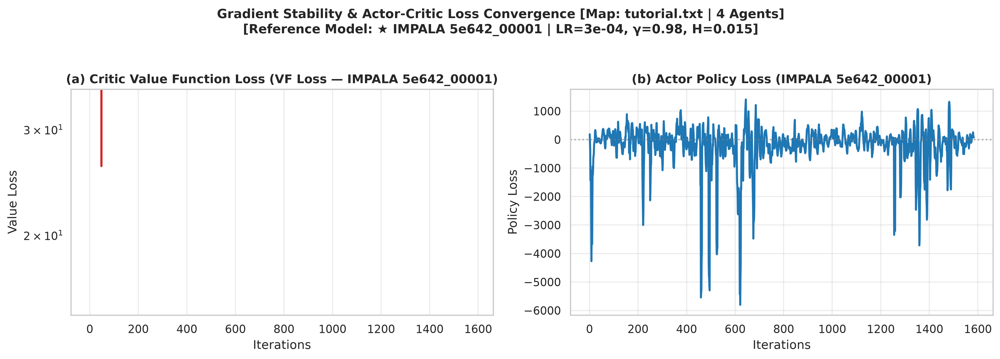

> **How to interpret:** Left panel shows critic Value Function Loss (`VF Loss`, log scale); right panel shows actor `Policy Loss`. Smooth, bounded trajectories confirm stable actor-critic optimization; persistent spikes or divergence suggest the learning rate is too high or reward magnitudes need recalibration.

---

[Back to main README](../README.md)
