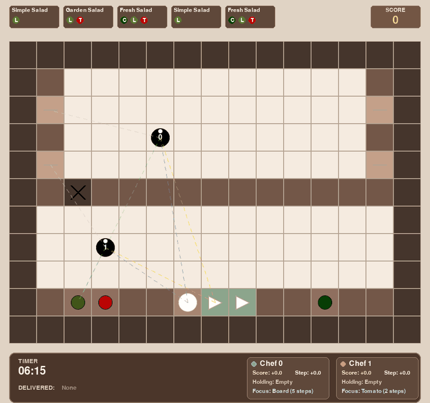
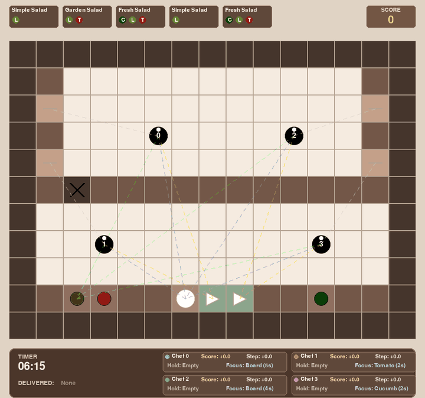
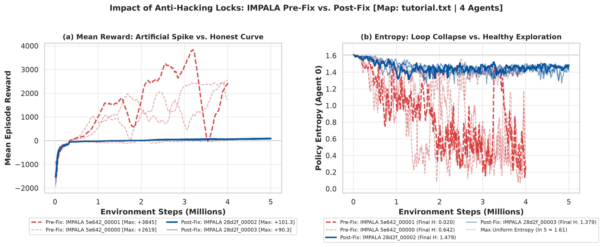
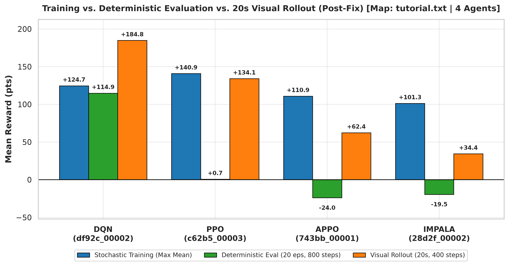
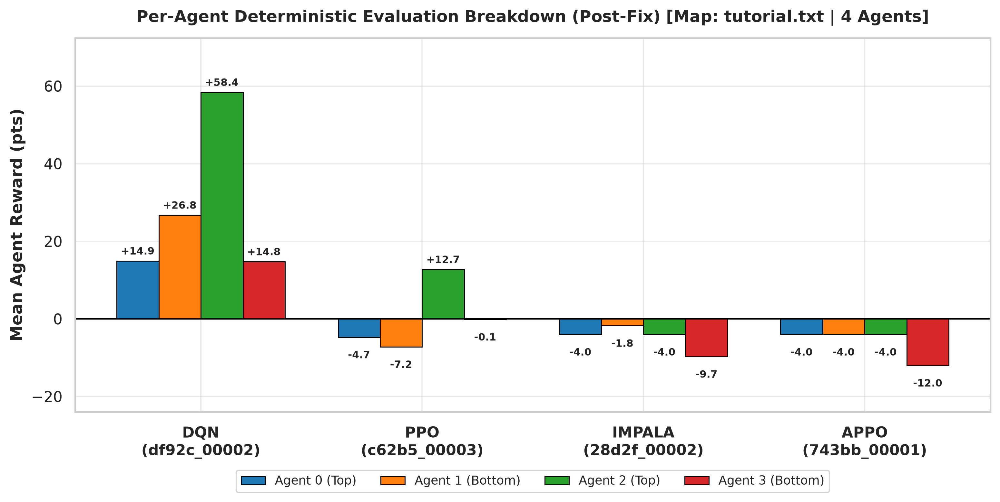
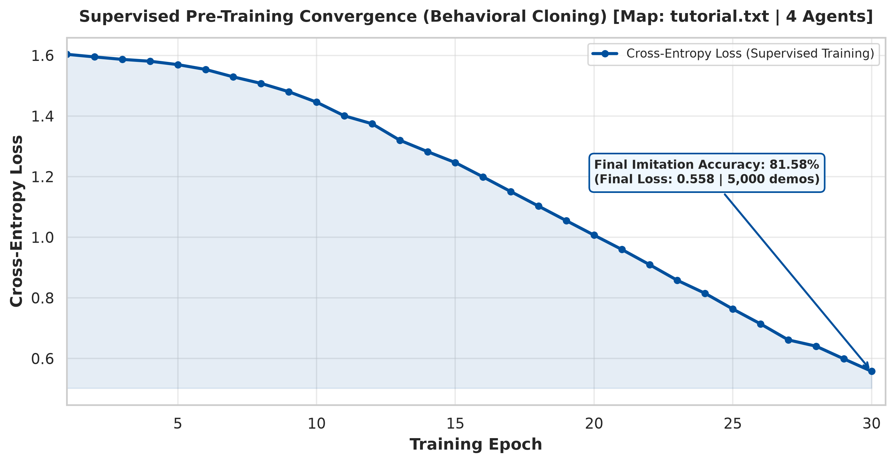
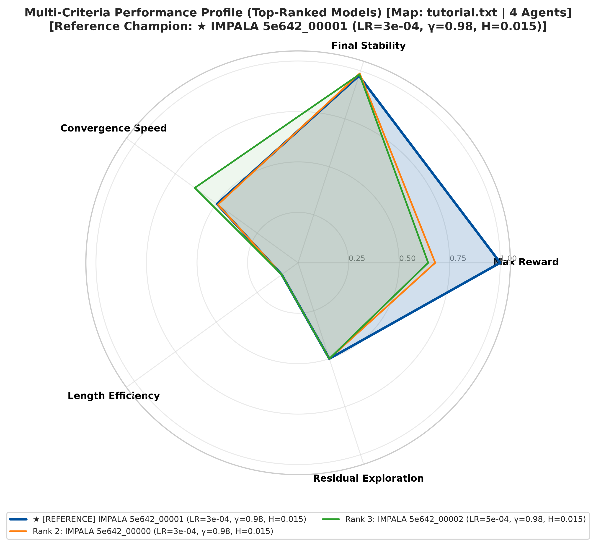

  

# Experiment Results & Analyses

This directory contains visual results, learning curves, algorithm benchmarks, and behavioral analyses for the Overcooked MARL environment, organized by experiment scale.

---

## Experiments

| Folder | Scope | Summary |
| :--- | :--- | :--- |
| [`01_visao_geral_e_evolucao/`](./01_visao_geral_e_evolucao/) | Overview & environment evolution (POC I vs. POC II) | ~90% faster decision time (`150D` featurized vector vs. `CNN`) and updated divided-kitchen HUD. |
| [`02_experimento_1_agente_cozinha_aberta/`](./02_experimento_1_agente_cozinha_aberta/) | 1-agent baseline in open kitchen (`default_map.txt`) | Consistent convergence across trials. |
| [`03_experimento_2_agentes_cooperacao/`](./03_experimento_2_agentes_cooperacao/) | 2-agent cooperation in divided kitchen (`tutorial.txt`) | Independent policies achieved 4 dishes/episode, including multi-ingredient salads. |
| [`04_experimento_4_agentes_e_algoritmos/`](./04_experimento_4_agentes_e_algoritmos/) | 4-agent multi-algorithm benchmark (`IMPALA`, `APPO`, `DQN`, `PPO`, `BC`) | Stage-level anti-hacking locks eliminated reward exploits; in the 3-day post-fix run (17 models), `PPO` reached the highest training mean (`+140.88`), `BC` achieved `81.58%` imitation accuracy, and `DQN` (`df92c_00002`) was the only model to preserve deterministic eval performance (`+114.87`) and combine 2 ingredients onto a plate (`+184.80` in 20s). |

---

## Post-Fix 4-Agent Benchmark Summary (3-Day Run)

After introducing stage-level anti-hacking locks (`place_stages_awarded`, `pickup_ready_awarded`, `place_on_station_awarded`), 17 models were trained across five paradigms on `tutorial.txt` (4 agents):

| Algorithm | Champion Trial | Steps | Max Train Mean | Deterministic Eval (20 eps) | 20s Visual Rollout | Key Takeaway |
| :--- | :--- | :---: | :---: | :---: | :---: | :--- |
| **DQN** | `df92c_00002` (`lr=2e-4, γ=0.98, n=5`) | 2.5M | `+124.66` | **`+114.87 ± 0.00`** | **`+184.80`** | Best stability and sample efficiency; only model to combine 2 ingredients (`cucumber + tomato`) on a plate. |
| **PPO** | `c62b5_00003` (`lr=1e-4, γ=0.99, H=0.02`) | 5.0M | **`+140.88`** | `+0.69 ± 0.00` | `+134.11` | Highest training mean (episode peak `+443.67`), but degrades under deterministic `argmax` due to high final entropy (`H=1.17`). |
| **APPO** | `743bb_00001` (`lr=3e-4, γ=0.99, H=0.02`) | 5.0M | `+110.87` | `-24.00 ± 0.00` | `+62.36` | Highest single-episode peak (`+512.47` in `743bb_00003`), sensitive to deterministic lockups (`H=1.36`). |
| **IMPALA** | `28d2f_00002` (`lr=5e-4, γ=0.98, H=0.015`) | 5.0M | `+101.32` | `-19.47 ± 0.00` | `+34.38` | Fastest throughput (~5.85h per 5M steps); still climbing at 5M steps with high entropy (`H=1.48`). |
| **BC** | `BC_20261126` (`lr=1e-3`, 30 epochs) | 5k demos | `81.58%` acc. | N/A | N/A | Monotonic cross-entropy convergence (`1.603 → 0.558`), ready for supervised warm-start. |

---

## Gameplay Previews

<table>
  <tr>
    <th align="center">2-Agent Cooperation (<code>tutorial.txt</code>)</th>
    <th align="center">4-Agent Team (<code>tutorial.txt</code>)</th>
  </tr>
  <tr>
    <td align="center" width="50%">
      
    </td>
    <td align="center" width="50%">
      
    </td>
  </tr>
</table>

---

## Key Diagnostic Charts (4-Agent Post-Fix Analysis)

### 1. Anti-Hacking Impact: IMPALA Pre-Fix vs. Post-Fix

  

> **What this shows:** Before the stage-level locks (`IMPALA 5e642_*`, dashed red), training reward exploded artificially to `+3,845` while policy entropy collapsed toward `0.02` as agents farmed repeated pickup/placement loops. After the fix (`IMPALA 28d2f_*`, solid blue), reward hacking disappears completely, leaving an honest upward learning curve (`+101.3`) with healthy policy entropy (`1.34–1.50`).

### 2. Clean-Scale Post-Fix Learning Curves by Algorithm

  

> **What this shows:** Removing the pre-fix `+3,845` outlier reveals the true post-fix progression in environment steps (0 to 5M). **DQN** (`df92c_00002`, green) reaches `+124.7` in half the steps (`2.5M`) of **PPO**, **APPO**, and **IMPALA** (`5.0M`), with all four families still trending upward at the end of the run.

### 3. Training vs. Deterministic Evaluation vs. 20s Visual Rollout Gap

  

> **What this shows:** Directly exposes the stochastic-to-deterministic transfer gap. **DQN** preserves nearly all of its training performance under greedy evaluation (`+124.7 → +114.9`) and leads the 20s rollout (`+184.8`). Policy-gradient methods (**PPO**, **APPO**, **IMPALA**) still retain high entropy at 5M steps and collapse under deterministic `argmax`.

### 4. Per-Agent Deterministic Evaluation Breakdown

  

> **What this shows:** Breaks down deterministic evaluation reward across all four chefs (`agent_0` and `agent_2` in the top zone; `agent_1` and `agent_3` in the bottom zone). Only **DQN** keeps all four agents positive (led by `agent_2` at `+58.4`), whereas **PPO**, **IMPALA**, and **APPO** exhibit negative lockups on multiple agents.

### 5. 20s Visual Rollout Timeline (Step 0 → 400) & Behavioral Cloning Convergence
<table>
  <tr>
    <td align="center" width="54%">
      
       Step-by-step cumulative reward over 400 steps: <code>DQN df92c_00002</code> plates cucumber (step 36) and tomato (step 42, 2/3 of <code>FRESH_SALAD</code>), then plateaus after step 57 due to early epsilon decay.
    </td>
    <td align="center" width="46%">
      
       Supervised Behavioral Cloning convergence over 30 epochs on 5,000 demonstration steps, reducing cross-entropy loss from <code>1.603</code> to <code>0.558</code> (<code>81.58%</code> imitation accuracy).
    </td>
  </tr>
</table>

### 6. Throughput & Multi-Criteria Profile
<table>
  <tr>
    <td align="center" width="50%">
      
       Training duration (hours) and sampling throughput (steps/s) across algorithms (5x–7x speedup with V-Trace).
    </td>
    <td align="center" width="50%">
      
       Multi-criteria profile comparing top models across stability, reward, and convergence dimensions.
    </td>
  </tr>
</table>

---

[Back to main README](../README.md)
