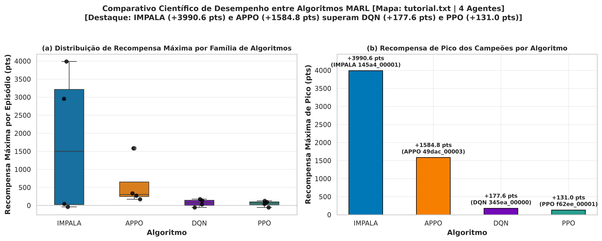

# Reinforcement Learning Experiments

Training, hyperparameter sweeps, quantitative evaluation, and rollout visualization pipelines for the **Overcooked MARL Environment** using **Ray RLlib**.

---

<div align="center">
<table>
  <tr>
    <td align="center" width="50%">
      
      <br/><sub><b>Multi-Algorithm Benchmark:</b> IMPALA, APPO, DQN, and PPO.</sub>
    </td>
    <td align="center" width="50%">
      
      <br/><sub><b>Trained Policy Rollout:</b> 4-agent brigade in <code>tutorial.txt</code>.</sub>
    </td>
  </tr>
</table>
</div>

> [!TIP]
> Browse all generated plots, learning curves, and benchmark reports in **[`resultados_experimentos/`](../resultados_experimentos/README.md)**.

## Directory Structure

```text
experiments/
├── training/        # Training scripts (PPO, DQN, IMPALA, APPO, BC) & automated cycles
├── analysis/        # Deterministic multi-episode evaluation & checkpoint discovery
├── visualization/   # Pygame graphical rollouts & Jupyter performance notebooks
├── utils/           # Persistent CSV/JSON results tracking & post-processing
├── ray_results/     # Ray Tune checkpoints & training event logs
└── logs/            # Unified metrics, summary tables & step-by-step vision logs
```

## Prerequisites

```bash
venv/bin/pip install "ray[rllib]" notebook seaborn
```

## How to Run

### 1. Training (`experiments/training/`)
```bash
# Automated training + evaluation cycle
./experiments/training/run_experiment_cycle.sh

# Direct parameterized training
venv/bin/python experiments/training/train_ppo.py --map default_map.txt --num-agents 1 --workers 2
```

### 2. Evaluation (`experiments/analysis/`)
```bash
# Multi-episode deterministic evaluation on the latest checkpoint
venv/bin/python experiments/analysis/evaluate_ppo.py --num-episodes 5

# With step-by-step vision analysis logging
venv/bin/python experiments/analysis/evaluate_ppo.py --num-episodes 5 --log-vision
```

### 3. Visualization (`experiments/visualization/`)
```bash
# Real-time Pygame rollout (auto-loads latest checkpoint if omitted)
python3 experiments/visualization/visualize_model.py [checkpoint_path]
```

---

⬅**[Back to Main Repository README](../README.md)**
