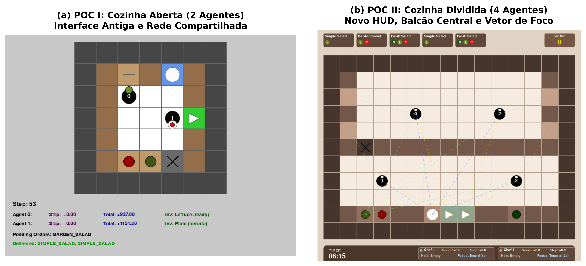

# Overcooked MARL Environment — Package Documentation

Modular Multi-Agent Reinforcement Learning (MARL) environment package featuring declarative JSON recipes, scale-invariant 150D observations, and a Station Strategy Pattern architecture.

---

<div align="center">
  
</div>

## Sub-Packages

| Module | Responsibility | Docs |
| :--- | :--- | :---: |
| **`core/`** | Items, multi-stage pipelines, `IngredientRegistry`, `RecipeManager`, `OrderQueue`, and constants | [README](./core/README.md) |
| **`environment/`** | `GameState`, `MapData`, 150D featurized vector & 9-channel spatial grid observation builders | [README](./environment/README.md) |
| **`map/`** | `.txt` map parsing, structural validation, and `MapLoader` facade with auto `recipes.json` discovery | [README](./map/README.md) |
| **`mechanics/`** | Movement, multi-agent collision resolution, PBRS `RewardShaper`, and Station Strategy Pattern handlers | [README](./mechanics/README.md) |
| **`rendering/`** | Pygame (`human`) graphical HUD and lightweight console (`ascii`) visualizers | [README](./rendering/README.md) |
| **`utils/`** | Shared utility module (reserved for cross-component helpers) | [README](./utils/README.md) |

<details>
<summary><b>Full Package Tree</b></summary>

```text
overcooked_marl_env/
├── __init__.py                 # Exports (OvercookedMARL, FeaturizedObservationBuilder, OrderQueue)
├── env.py                      # Main environment wrapper (OvercookedMARL)
├── overcooked_marl_v0.py       # PettingZoo ParallelEnv interface
├── core/                       # items.py, recipes.py, constants.py, default_*.json
├── environment/                # game_state.py, observation_builder.py, featurized_observation_builder.py
├── map/                        # map_loader.py, map_parser.py, map_validator.py, maps/
├── mechanics/                  # movement_system.py, collision_resolver.py, reward_shaper.py, interactions/
├── rendering/                  # renderer.py, render_config.py
├── utils/                      # Shared helpers
└── tests/                      # Unit and integration test suite
```
</details>

## Core Architecture Highlights

* **Core (`core/`):** Multi-stage processing pipelines (`stages`), instant-ready ingredients (`cuts_needed: 0`), character-less ingredient IDs, deterministic FIFO `OrderQueue`, and declarative JSON recipe loading.
* **Observations (`environment/`):**
  * **150D Featurized Vector (Default):** Scale-invariant layout — `[0:24]` Self State, `[24:32]` Facing Tile Vision, `[32:80]` Partner Agents (up to 3×16), `[80:100]` HUD Orders (2×10), `[100:108]` Attentive Dispensers, `[108:132]` Fixed Stations & Beacons, `[132:150]` Counters & Transfer Midpoints.
  * **9-Channel Spatial Grid:** Tensor representation `(H, W, 9)` for convolutional policies.
* **Mechanics (`mechanics/`):** Every kitchen station (`C`, `P`, `I`, `#`, `T`, `D`) is an isolated `StationHandler` dynamically dispatched via `StationRegistry`, paired with Potential-Based Reward Shaping (`RewardShaper`).

## Testing & Verification

```bash
./venv/bin/python -m unittest discover -s overcooked_marl_env/tests
```

---

⬅**[Back to Main Repository README](../README.md)**
