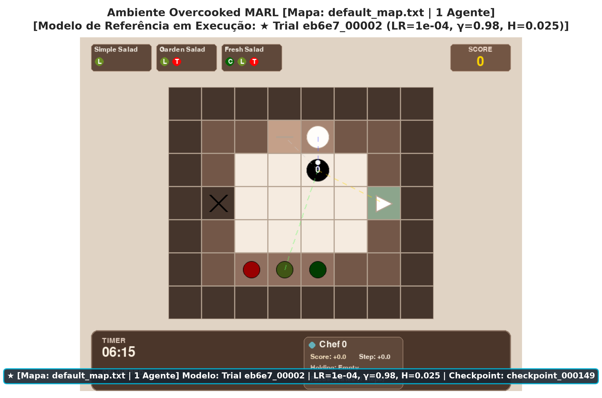
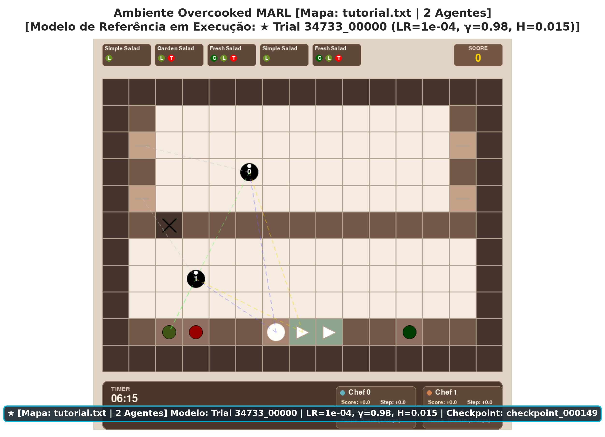

# Map System — Loading, Parsing, and Validation

Loads, parses, and validates `.txt` kitchen layouts using a **Facade** (`MapLoader`), with automatic discovery of adjacent `recipes.json` files.

---

<div align="center">
<table>
  <tr>
    <td align="center" width="50%">
      
      <br/><sub><b><code>default_map.txt</code> (7×7):</b> Open kitchen layout.</sub>
    </td>
    <td align="center" width="50%">
      
      <br/><sub><b><code>tutorial.txt</code> (15×11):</b> Divided multi-agent kitchen (up to 4 agents).</sub>
    </td>
  </tr>
</table>
</div>

## Sub-package Contents

```text
map/
├── __init__.py          # Module exports
├── map_config.py        # Map headers and dimension limits
├── map_parser.py        # Parses .txt layouts (# Grid Map, # Dispensers, # Recipes)
├── map_validator.py     # Structural & semantic validation (3x3 to 50x50, spawns, recipes)
├── map_loader.py        # Facade loader + CLI validation utility
└── maps/                # Included layouts (default_map.txt, tutorial.txt)
```

## Architecture

* **Parser (`map_parser.py`):** `parse_file(map_path)` extracts grid arrays, agent spawns, dispenser mappings, and recipe lists.
* **Validator (`map_validator.py`):** `validate_map(map_data)` checks required keys, 2D `uint8` grid, dimensions (`3×3` to `50×50`), in-bounds non-overlapping agent spawns, dispenser coordinates/names, and recipe validity against [`RecipeManager`](../core/recipes.py).
* **Facade Loader (`map_loader.py`):** `load_map(map_path)` coordinates parsing, validation, fallback maps, dependency injection (`RecipeManager`, `ItemManager`), and auto-loading adjacent `recipes.json`.

## CLI Validation & Unit Tests

```bash
# Validate any map file (auto-loads adjacent recipes.json if present)
python -m overcooked_marl_env.map.map_loader example/custom_map_template.txt

# Run map subsystem tests
python -m unittest overcooked_marl_env/tests/unit/test_map_parser.py
python -m unittest overcooked_marl_env/tests/unit/test_map_validator.py
python -m unittest overcooked_marl_env/tests/unit/test_map_loader.py
```

---

⬅**[Back to Package Documentation](../README.md)**
