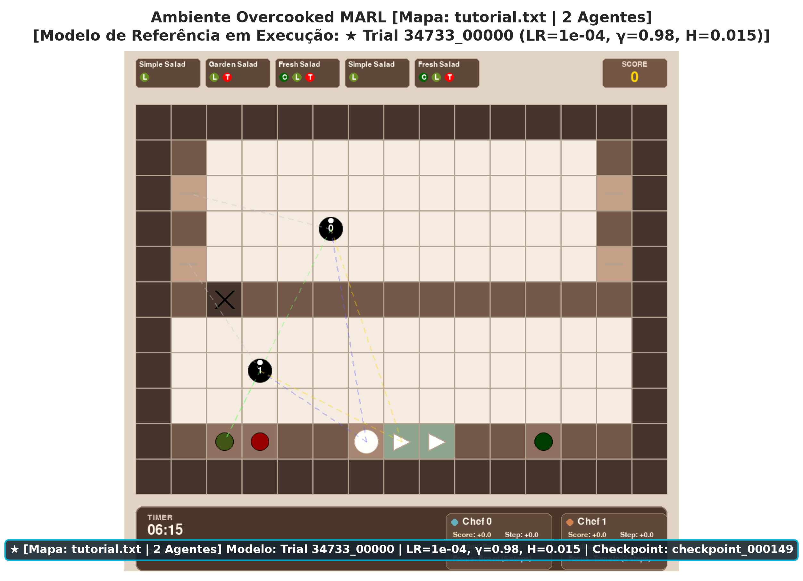

<div align="center">


# 🎨 Rendering System — Pygame HUD & ASCII Visualization

Dual visualization backend providing a real-time Pygame graphical HUD (`render_mode="human"`) and a lightweight console ASCII renderer (`render_mode="ascii"`).

</div>


<div align="center">
  
</div>

## 📁 Sub-package Contents

```text
rendering/
├── __init__.py      # Module exports
├── render_config.py # Pygame color themes, FPS, and grid layout settings
└── renderer.py      # Main Renderer class (render & close)
```

## 🖥️ Rendering Modes

* **Pygame Mode (`render_mode="human"`):** Color-coded kitchen grid, directional agent circles, held item & plate icons, plus a dedicated HUD displaying step count, rewards, and pending recipe orders.
* **ASCII Mode (`render_mode="ascii"`):** Lightweight terminal output ideal for headless server training (`_`/`|` walls, `#` counters, lowercase chopped ingredients `t/l/c/o`, scores, and order queue).

## 🧪 Testing & Visual Demos

```bash
# Unit tests
python -m unittest overcooked_marl_env/tests/test_renderer.py

# ASCII console demo
python example/default_map_test.py

# Interactive Pygame keyboard play
python example/keyboard_play.py
```


⬅️ **[Back to Package Documentation](../README.md)**
