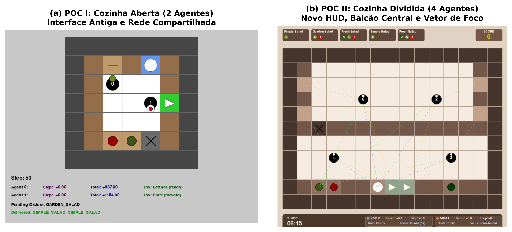
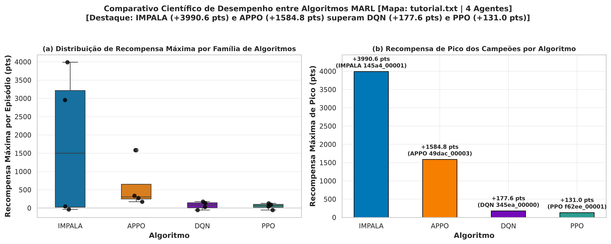
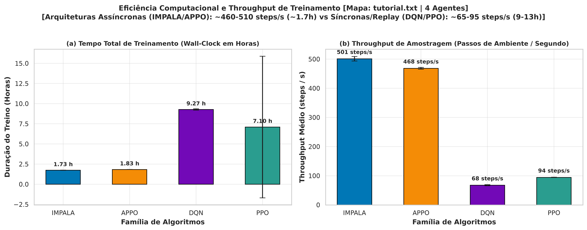

# 🌟 01 — Overview & Environment Evolution

Visual comparison between **POC I** (open kitchen + CNN observation) and **POC II** (divided kitchen + 150D featurized observation with focus rays), alongside multi-algorithm and scaling benchmarks.

  

 

<table>
  <tr>
    <td align="center" width="50%">
      
       <b>Algorithm Benchmark (4 Agents):</b> IMPALA (+3,990.6 pts), APPO (+1,584.8 pts), DQN (+177.6 pts), and PPO (+131.0 pts).
    </td>
    <td align="center" width="50%">
      
       <b>Training Efficiency:</b> Wall-clock time (hours) and sampling throughput (steps/s).
    </td>
  </tr>
</table>

<b>📑 All Figures in this Folder (9 files)</b>

* [`evolucao_ambiente_poc1_vs_poc2.png`](./evolucao_ambiente_poc1_vs_poc2.png) — Side-by-side comparison of POC I vs. POC II.
* [`cozinha_aberta_poc1.png`](./cozinha_aberta_poc1.png) — POC I open kitchen screenshot.
* [`cozinha_dividida_2_agentes.png`](./cozinha_dividida_2_agentes.png) — POC II divided kitchen (`tutorial.txt`) with 2 agents.
* [`cozinha_dividida_4_agentes.png`](./cozinha_dividida_4_agentes.png) — POC II divided kitchen (`tutorial.txt`) with 4 agents.
* [`comparacao_algoritmos_marl.png`](./comparacao_algoritmos_marl.png) — Reward distribution across MARL algorithm families.
* [`tempo_treino_e_eficiencia_algoritmos.png`](./tempo_treino_e_eficiencia_algoritmos.png) — Training duration and throughput comparison.
* [`comparacao_escalabilidade_agentes.png`](./comparacao_escalabilidade_agentes.png) — Agent scaling distribution and learning dynamics.
* [`comparacao_geral_desempenho.png`](./comparacao_geral_desempenho.png) — Overall model ranking and convergence effort.
* [`comparacao_geral_hiperparametros.png`](./comparacao_geral_hiperparametros.png) — Global hyperparameter sensitivity (LR, Entropy, Gamma).

⬅️ **[Back to Results Index](../README.md)**
