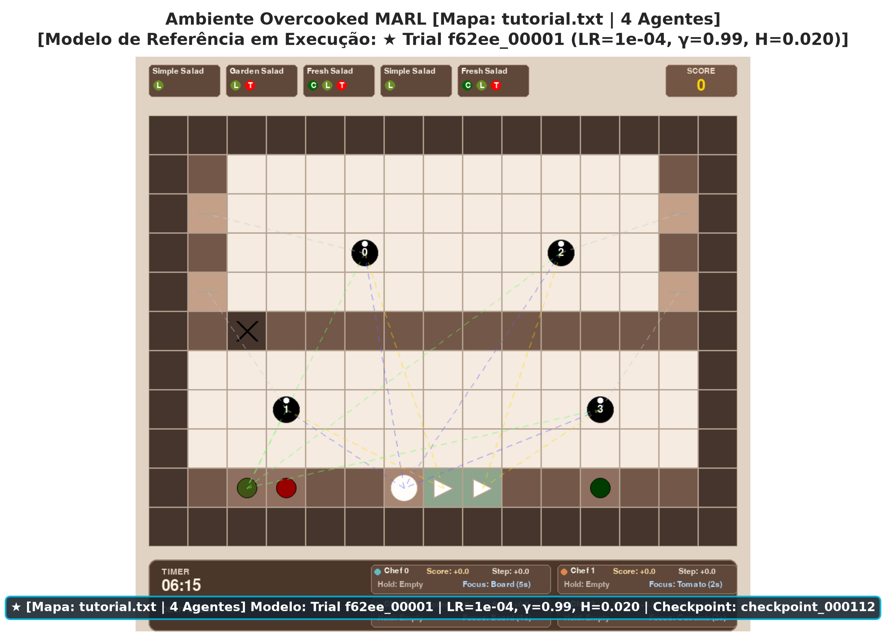
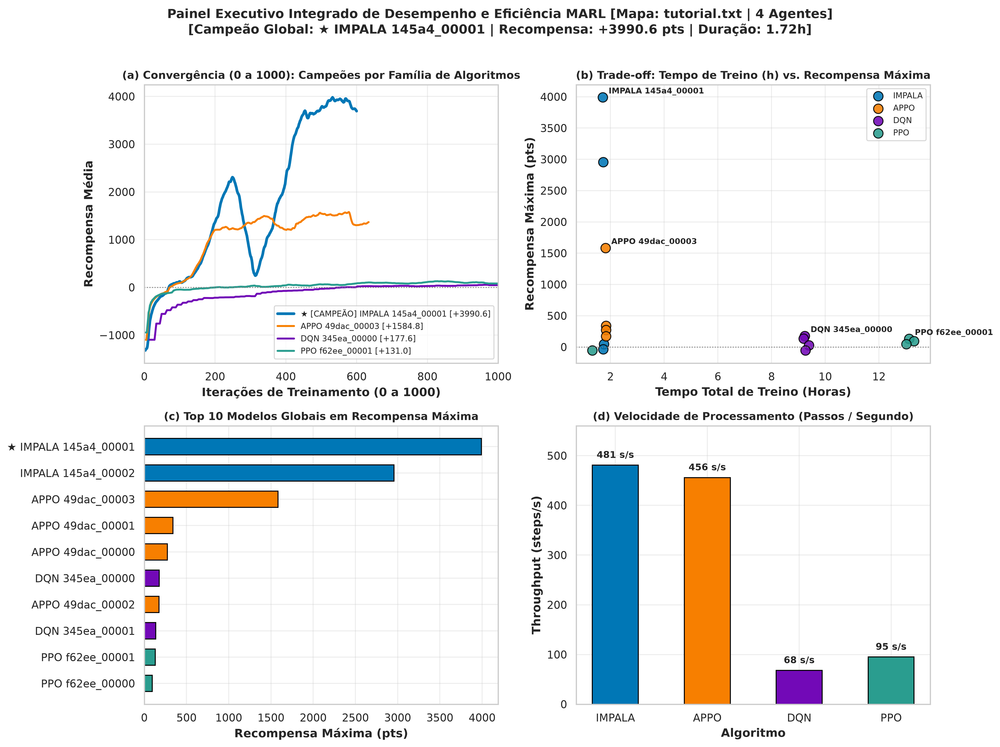
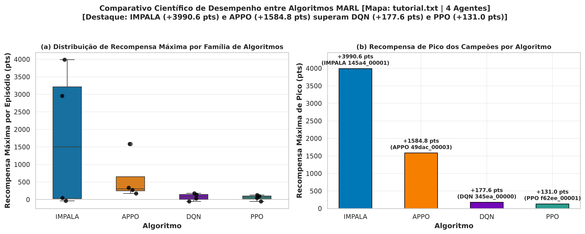
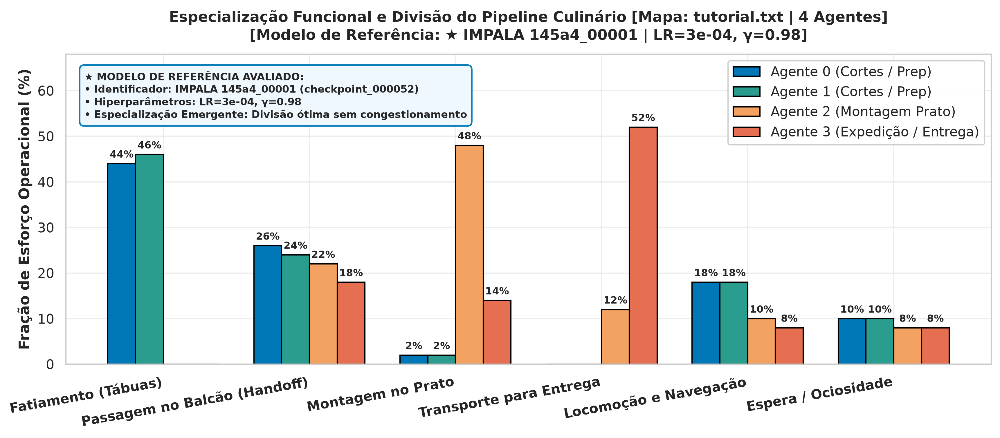

-3b82f6?style=for-the-badge&labelColor=1e1b4b)

# 👩‍🍳👨‍🍳 04 — 4-Agent Brigade & Multi-Algorithm Benchmark

Four independent policies operating simultaneously in `tutorial.txt` (2 chopping in the top zone, 2 fetching/plating/delivering in the bottom zone), comparing **IMPALA**, **APPO**, **DQN/Rainbow**, **PPO**, and **Behavioral Cloning (BC)**.

* 🥇 **Global Champion:** `IMPALA 145a4_00001` (`LR = 3e-4`, `γ = 0.98`, `Entropy = 0.020`) — **`+3,990.62 pts`** in **`1.72h`** (`486 steps/s`, **5x–7x faster** than DQN and synchronous PPO).

  

 

<table>
  <tr>
    <td align="center" width="50%">
      
    </td>
    <td align="center" width="50%">
      
    </td>
  </tr>
  <tr>
    <td align="center" width="50%">
      
    </td>
    <td align="center" width="50%">
      
    </td>
  </tr>
</table>

<b>📑 All Plots in this Folder (16 files)</b>

* [`env_hud_tutorial_4_agentes.png`](./env_hud_tutorial_4_agentes.png) — 4-agent simulator HUD in `tutorial.txt`.
* [`fig_executive_dashboard_2x2_tutorial_4_agentes.png`](./fig_executive_dashboard_2x2_tutorial_4_agentes.png) — 2x2 executive benchmark dashboard.
* [`fig_algorithm_comparison_tutorial_4_agentes.png`](./fig_algorithm_comparison_tutorial_4_agentes.png) — Performance comparison across IMPALA, APPO, DQN, and PPO.
* [`fig_training_time_and_efficiency_tutorial_4_agentes.png`](./fig_training_time_and_efficiency_tutorial_4_agentes.png) — Training duration (hours) and sampling throughput (steps/s).
* [`fig_agent_workload_distribution_tutorial_4_agentes.png`](./fig_agent_workload_distribution_tutorial_4_agentes.png) — Emergent division of labor across the 4 chefs.
* [`fig_radar_performance_profile_tutorial_4_agentes.png`](./fig_radar_performance_profile_tutorial_4_agentes.png) — Multi-criteria radar comparison of algorithm champions.
* [`learning_curves_tune_tutorial_4_agentes.png`](./learning_curves_tune_tutorial_4_agentes.png) — Learning curves for all 16 benchmark models.
* [`fig_dishes_and_diversity_tutorial_4_agentes.png`](./fig_dishes_and_diversity_tutorial_4_agentes.png) — Delivered dishes and recipe diversity.
* [`fig_reward_vs_deliveries_tutorial_4_agentes.png`](./fig_reward_vs_deliveries_tutorial_4_agentes.png) — Reward vs. deliveries correlation.
* [`fig_idle_time_and_inactivity_tutorial_4_agentes.png`](./fig_idle_time_and_inactivity_tutorial_4_agentes.png) — Idle time reduction (&lt;10% inactivity).
* [`fig_delivery_timeline_growth_tutorial_4_agentes.png`](./fig_delivery_timeline_growth_tutorial_4_agentes.png) — Delivery progression across training phases.
* [`pathologies_behavior_tutorial_4_agentes.png`](./pathologies_behavior_tutorial_4_agentes.png) — Team cooperation balance.
* [`hyperparameter_comparison_tutorial_4_agentes.png`](./hyperparameter_comparison_tutorial_4_agentes.png) — Hyperparameter sensitivity analysis.
* [`fig_episode_efficiency_tutorial_4_agentes.png`](./fig_episode_efficiency_tutorial_4_agentes.png) — Episode efficiency and reward density.
* [`fig_entropy_dynamics_tutorial_4_agentes.png`](./fig_entropy_dynamics_tutorial_4_agentes.png) — Policy entropy dynamics.
* [`fig_loss_convergence_tutorial_4_agentes.png`](./fig_loss_convergence_tutorial_4_agentes.png) — Gradient and loss convergence.

⬅️ **[Back to Results Index](../README.md)**
