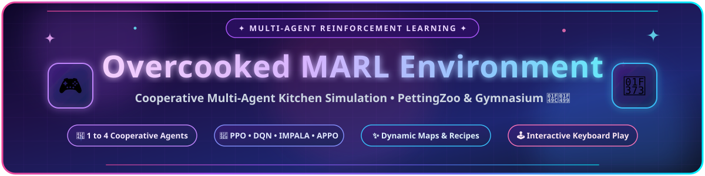
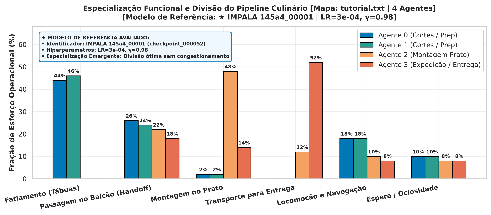
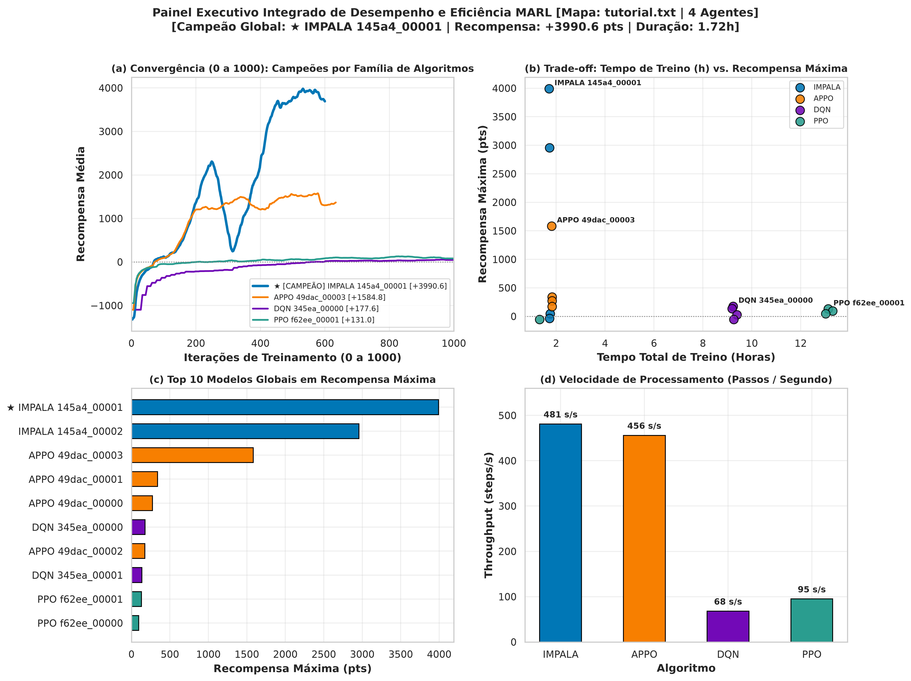

 

# 💜 Experiment Results & Analyses

This directory contains all visual results, learning curves, algorithm benchmarks, and behavioral analyses for the **Overcooked MARL Environment**, organized by experiment scale for easy browsing.

---

## 🗂️ Folders by Experiment

| Folder | Experiment / Scope | Key Highlight |
| :--- | :--- | :--- |
| 📁 **[`01_visao_geral_e_evolucao/`](./01_visao_geral_e_evolucao/)** | **Overview & Environment Evolution** (POC I vs. POC II) + cross-algorithm comparisons. | **88.6% faster inference** (`150D` vector vs. `CNN`) & new divided kitchen HUD. |
| 📁 **[`02_experimento_1_agente_cozinha_aberta/`](./02_experimento_1_agente_cozinha_aberta/)** | **1-Agent Baseline Validation** in the open kitchen (`default_map.txt`). | **100% convergence** across trials; champion reached **`+11,281.0 pts`**. |
| 📁 **[`03_experimento_2_agentes_cooperacao/`](./03_experimento_2_agentes_cooperacao/)** | **2-Agent Mandatory Cooperation** in the divided kitchen (`tutorial.txt`). | **+322% score jump** (`+1,911 pts` in 20s), **4 dishes/episode**, and solved *Counter Farming* & *Lazy Agent*. |
| 📁 **[`04_experimento_4_agentes_e_algoritmos/`](./04_experimento_4_agentes_e_algoritmos/)** | **4-Agent Brigade & Multi-Algorithm Benchmark** (`IMPALA`, `APPO`, `DQN`, `PPO`, `BC`). | **IMPALA** achieved the global record (**`+3,990.6 pts` in `1.72h`**), **5x–7x faster** than DQN/PPO. |

## 🎬 Gameplay Previews

<table>
  <tr>
    <th align="center">👯‍♀️ 2-Agent Cooperation (`tutorial.txt`)</th>
    <th align="center">👩‍🍳👨‍🍳 4-Agent Team (`tutorial.txt`)</th>
  </tr>
  <tr>
    <td align="center" width="50%">
      
    </td>
    <td align="center" width="50%">
      
    </td>
  </tr>
</table>

## 🏆 Key Visual Highlights

<table>
  <tr>
    <td align="center" width="50%">
      
       <b>Emergent Division of Labor (4 Agents):</b> 2 agents specialize in chopping (44% & 46%), 1 in plating (48%), and 1 in delivery (52%).
    </td>
    <td align="center" width="50%">
      
       <b>4-Agent Multi-Algorithm Dashboard:</b> Convergence, training time vs. reward, Top 10 models, and throughput (steps/s).
    </td>
  </tr>
</table>

---

⬅️ **[Back to Main Repository README](../README.md)**
