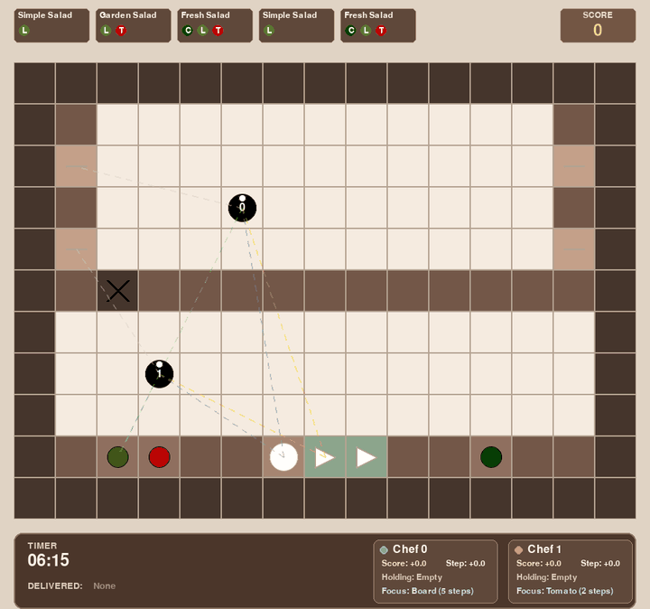
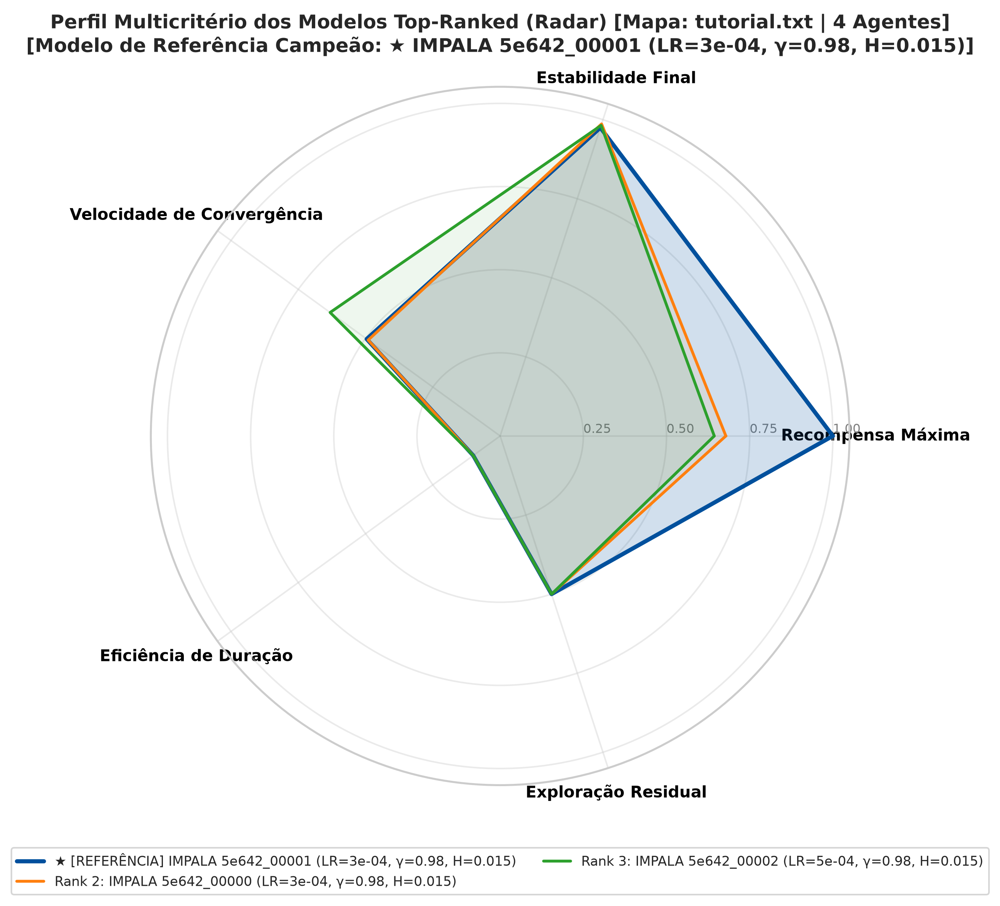

  

# Experiment Results & Analyses

This directory contains visual results, learning curves, algorithm benchmarks, and behavioral analyses for the Overcooked MARL environment, organized by experiment scale.

---

## Experiments

| Folder | Scope | Summary |
| :--- | :--- | :--- |
| [`01_visao_geral_e_evolucao/`](./01_visao_geral_e_evolucao/) | Overview & environment evolution (POC I vs. POC II) | ~90% faster decision time (`150D` featurized vector vs. `CNN`) and updated divided-kitchen HUD. |
| [`02_experimento_1_agente_cozinha_aberta/`](./02_experimento_1_agente_cozinha_aberta/) | 1-agent baseline in open kitchen (`default_map.txt`) | Consistent convergence across trials. |
| [`03_experimento_2_agentes_cooperacao/`](./03_experimento_2_agentes_cooperacao/) | 2-agent cooperation in divided kitchen (`tutorial.txt`) | Independent policies achieved 4 dishes/episode, including multi-ingredient salads. |
| [`04_experimento_4_agentes_e_algoritmos/`](./04_experimento_4_agentes_e_algoritmos/) | 4-agent multi-algorithm benchmark (`IMPALA`, `APPO`, `DQN`, `PPO`, `BC`) | Asynchronous methods (`IMPALA`, `APPO`) achieved 5x–7x higher throughput; visual inspection highlighted non-stationarity and counter reward-shaping exploits. |

---

## Gameplay Previews

<table>
  <tr>
    <th align="center">2-Agent Cooperation (<code>tutorial.txt</code>)</th>
    <th align="center">4-Agent Team (<code>tutorial.txt</code>)</th>
  </tr>
  <tr>
    <td align="center" width="50%">
      
    </td>
    <td align="center" width="50%">
      
    </td>
  </tr>
</table>

---

## Key Charts

<table>
  <tr>
    <td align="center" width="50%">
      
       Training duration (hours) and sampling throughput (steps/s) across algorithms.
    </td>
    <td align="center" width="50%">
      
       Multi-criteria comparison across IMPALA, APPO, DQN, and PPO.
    </td>
  </tr>
</table>

---

[Back to main README](../README.md)
